# Bellhop

<p align="center">
  
</p>

<p align="center">
  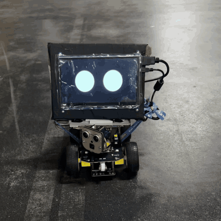
</p>

<p align="center">
  <b>Edge AI on a Raspberry Pi robot, wired into a real backend<a href="#wired-into-a-real-backend">*</a> and a live nurse dashboard.</b><br>
  Built at Cal Hacks 13.0 · <a href="artifacts/hardware/media/bellhop-demo.mp4">Robot demo</a> · <a href="https://www.youtube.com/watch?v=vnsqGMfTnL8">Devpost video</a> · <a href="https://devpost.com/software/bellhop">Devpost</a>
</p>

**Bellhop is a robot that answers the call bell in a care home.** Most bell presses are not
emergencies. They are a drink, a chat, a question or a small request, and each one still pulls a
nurse away from residents who need hands. Bellhop sends a robot to the room instead. It drives
there, greets the resident by name, talks with them, and calls a nurse the moment something is
urgent.

<table>
<tr>
<td width="33%">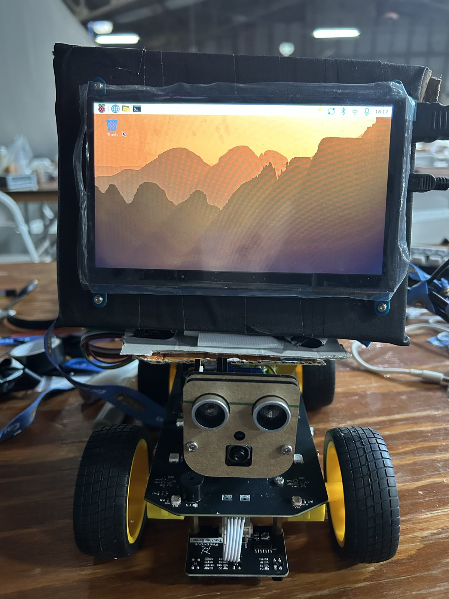</td>
<td width="33%">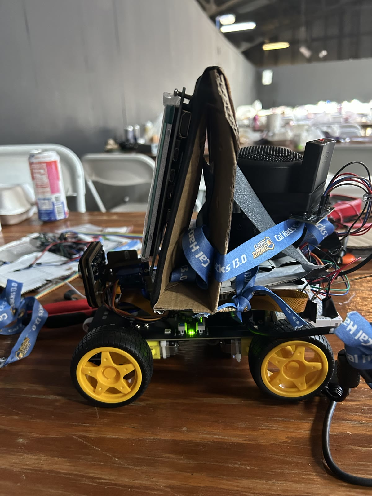</td>
<td width="33%">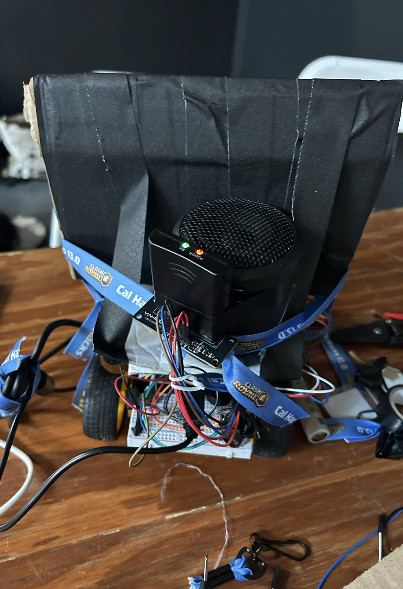</td>
</tr>
</table>

*The robot as built at Cal Hacks: a Freenove 4WD chassis and a Raspberry Pi 5, with the kit's
ultrasonic sensor and camera under a 7 inch touchscreen face. We built the screen's enclosure from
cardboard and black tape, and the venue had no zip ties, so it is held on with Cal Hacks 13.0
Clash Royale lanyards.*

---

## On the real robot

Every clip below is the robot itself at Cal Hacks, cut from the
[90 second demo](artifacts/hardware/media/bellhop-demo.mp4).

<table>
<tr>
<td width="33%" valign="top">
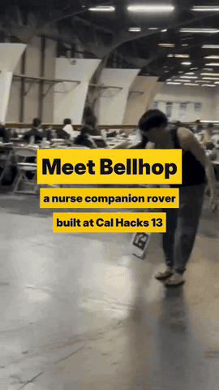
<br><b>Drives to the marker.</b> It spots an ArUco marker and drives itself there. Here the
marker is carried across the venue floor and the robot follows it.
</td>
<td width="33%" valign="top">
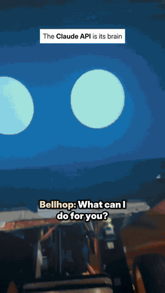
<br><b>Feels it.</b> "Well, my cat died." Each reply carries a tone tag, which sets the eyes and
the voice's pitch, so the eyes droop and the voice changes with them.
</td>
<td width="33%" valign="top">
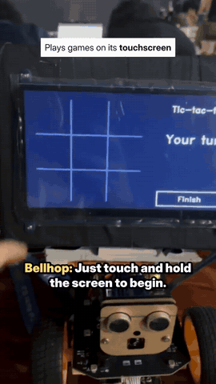
<br><b>Plays.</b> Bingo, tic-tac-toe and memory match on its touchscreen, opened by Claude when
the resident asks.
</td>
</tr>
<tr>
<td width="33%" valign="top">
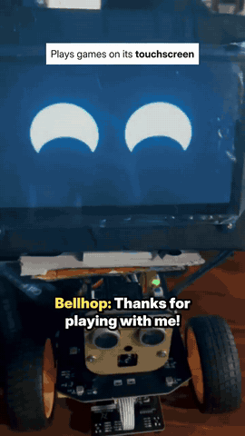
<br><b>Reads.</b> Twelve classic short stories, read aloud in parts with pauses where it can still
hear the resident. News and trends come through Apify.
</td>
<td width="33%" valign="top">
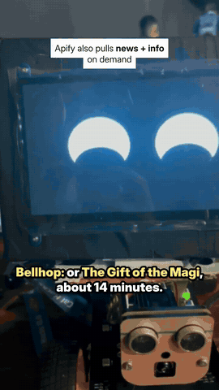
<br><b>Asks for a nurse.</b> "I'm hurt, I need a nurse." Claude calls its `request_staff` tool.
During a visit that raises the call to urgency 3, "nurse soon", and the dashboard alerts a nurse.
</td>
<td width="33%" valign="top">
<a href="https://www.youtube.com/watch?v=vnsqGMfTnL8">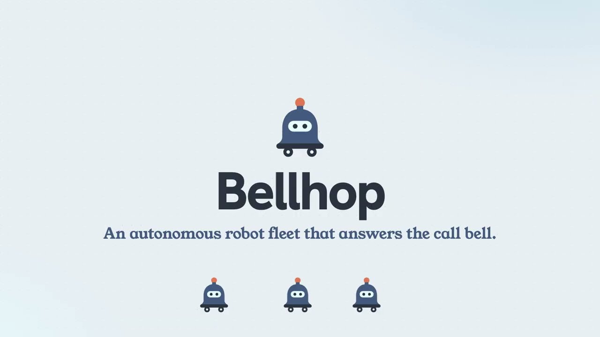</a>
<br><b>Watch it.</b> The <a href="artifacts/hardware/media/bellhop-demo.mp4">90 second robot demo</a>
these clips come from, with sound: the wake word, a chat that remembers the cat, a game, a story
and a call for a nurse. And the <a href="https://www.youtube.com/watch?v=vnsqGMfTnL8">Devpost
video</a> on YouTube.
</td>
</tr>
</table>

---

## Edge AI: what runs on the robot

<p align="center">
  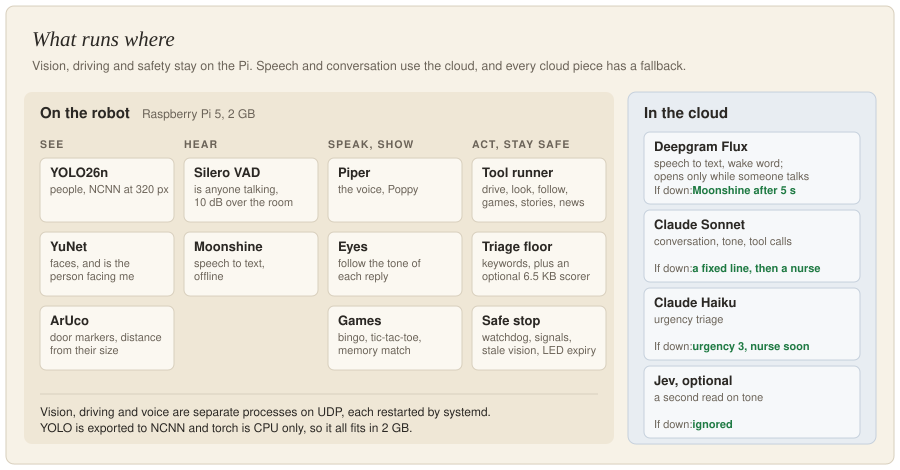
</p>

- **Two speeds.** Gordon designed navigation as a fast loop on the Pi (YOLO26n, YuNet and the
  ultrasonic steer and stop) and a slow loop where Claude reads a frame every 10 s to set the next
  waypoint. The slow loop is configured (`PLANNER_PERIOD_S`) but not on any pushed branch; today
  Claude sees the camera only through its `look` tool.
- **Cloud speech, by measurement.** Gordon benchmarked Deepgram Flux against local models in the
  loud venue. Flux held up far better, so Moonshine is the fallback.
- **Jev first, Claude Haiku second.**<sup>\*</sup> Gordon made TypeSafe's Jev the primary triage and
  tone model because it is faster and gives probabilities. Triage waits up to 1.5 s for Jev, and a
  score at 0.7 confidence or higher is posted on its own. If Jev is unsure, slow or down, Claude
  Haiku decides and the higher urgency wins.
  <br><sub>\* As built in `2bb1595`. `master` currently runs Claude first, with Jev as an optional
  check that can only raise urgency.</sub>
- **Fallbacks lean toward a nurse.** Confidence under 0.6 bumps urgency a level, the local floor can
  only raise it, and urgency never drops on a call.
- **A 6.5 KB triage head** on `bge-small-en-v1.5` embeddings. On 156 held-out lines it lifts urgent
  recall from 0.53 (keywords alone) to 0.88, but false-alarms on 18% of calm lines ("I didn't
  fall"), so it ships off by default. A Claude coding agent wrote the labels, not a
  person. [Numbers](ml/dev/train/RESULTS.txt).

---

## How the robot finds a room

No map: a printed ArUco marker on every door. The backend sends `POST /go_to` with a room, and the
Pi maps that room to its marker and runs this loop.

<p align="center">
  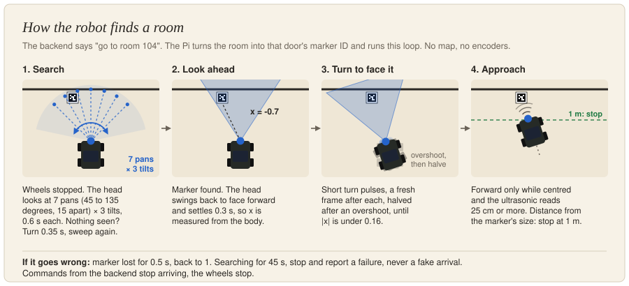
</p>

Distance comes from the marker's size in the frame. This is `MarkerNavigator` on `master`; a
taped-line approach sits on the unmerged `navigation_gordon` branch.

---

## Wired into a real backend\*

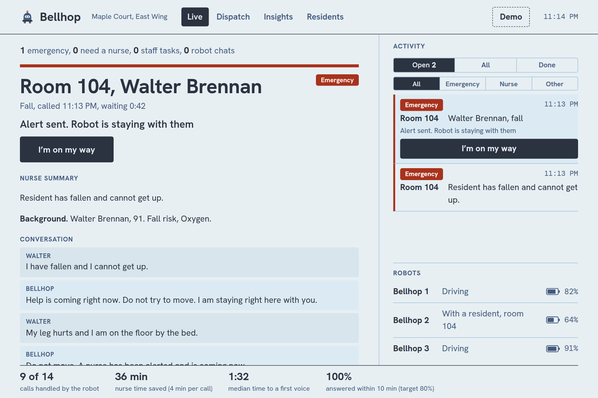

*The nurse dashboard during a fall, with the robot's conversation streaming in. Example residents
and calls from the simulator (`scripts/dev.sh mock`), not a real home.*

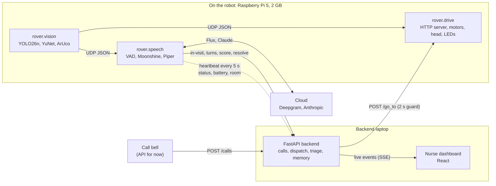

One bell press, end to end:

1. A bell press sends `POST /calls {room}` to the backend. For now the call comes from the API; a
   physical bell button is on the hardware list.
2. The backend picks the closest free robot and calls the Pi's `POST /go_to {room}`. If the Pi
   does not answer within 2 s, the call goes to the least-loaded nurse with an alert instead.
3. The Pi turns the room into a door marker, scans for it with the camera head, turns to face it
   in short camera-checked pulses, and drives with the ultrasonic sensor guarding every forward
   move.
4. When the marker is 1 m away, or a face looks at the robot for 1 s, the visit starts
   (`POST /calls/{id}/in-visit`).
5. Every line of the conversation is posted to the backend and scored in the background. The LEDs
   show the state: listening, nurse on the way, emergency.
6. Urgency 1 or 2: the robot resolves the call itself. Urgency 3 or 4: it stays and keeps the
   resident talking until a nurse taps "I'm on my way" on the dashboard.

The robot reports its status, battery and room every 5 s. Undervoltage reports a fault, and
dispatch skips a robot that is faulted or charging. The Pi and the laptop reach each other over
Tailscale, and [`scripts/live-demo.sh`](scripts/live-demo.sh) starts the whole stack (backend,
dashboard, and the robot over SSH) with one command.

<sub>\* Every link in this chain is built and tested end to end against the real backend with a
simulated Pi (148 checks). Running the whole chain on the robot itself is the next milestone;
[where it stands](#built-in-parallel).</sub>

---

## Engineering challenges

### Steering with no encoders: a controls problem

PROBLEM: No wheel encoders, no IMU, no differential to measure. A turn is "this PWM duty for this
long", and how far that rotates the chassis depends on the battery, the floor and the tyres. The
plant's gain is unknown, and the only sensor, the camera, blurs while the robot moves. Timed,
open-loop turns overshot or fell short.

SOLUTION: Close the loop through the camera. Jeremy proposed sampling the heading, guessing a
pulse, and repeating until it converges; Aditya built it as
[`_align_marker_heading`](ml/pi/src/rover/drive/navigator.py). Turn, stop, settle 0.12 s, measure
on a fresh frame. The pulse scales with the error, and every overshoot halves it.

<p align="center">
  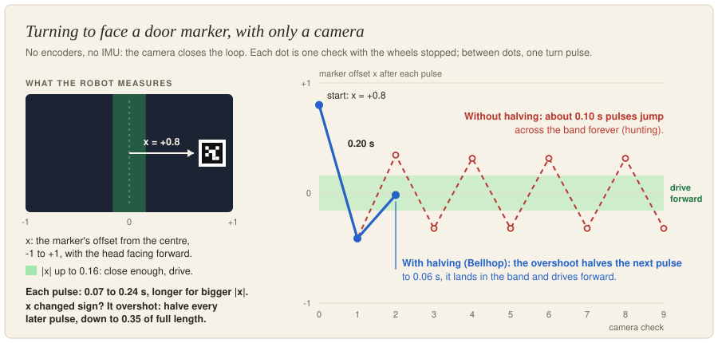
</p>

*Without halving (dashed), even the shortest pulse jumps the dead band, so the robot hunts forever.
With halving (solid), it lands on the second pulse. Simulated: the real `_align_marker_heading`
against an assumed turn rate of 200 degrees per second.*

On `master` the pan angle only aims the camera; once the head recentres, steering uses x alone.
`navigation_gordon` already turns the body toward the side the head found the marker on. Next
step: use the angle itself, not just its side, to size the first pulse.

### Reaching the robot over the venue network

PROBLEM: The venue Wi-Fi and the laptop's WSL shell blocked direct connections to the Pi.

SOLUTION: Raspberry Pi Connect for a shell, Tailscale between the Pi and the laptop, and an SSH
tunnel in [`live-demo.sh`](scripts/live-demo.sh) that starts the whole stack. Pi Connect and
Tailscale both gave us trouble the entire weekend.

### Losing the Pi at 11 pm

PROBLEM: At 11 pm, ten hours before the 9 am deadline, the Pi's operating system was corrupted.

SOLUTION: Reflash it and reinstall the entire stack. Next time: a known-good image, ready to flash.

More from the bench (screen brownouts, 2 GB of RAM, the PS2 pins) is in the
[build log](artifacts/hardware/README.md#problems-on-the-bench).

---

## Built in parallel

Four people built Bellhop between Friday evening and Sunday morning.
The backend, dashboard and simulator came together on `master` through a dozen pull requests and
are tested as one system. The robot did not come together as cleanly. Its features were built on
separate branches against the same few files, and they do not yet run as one robot.

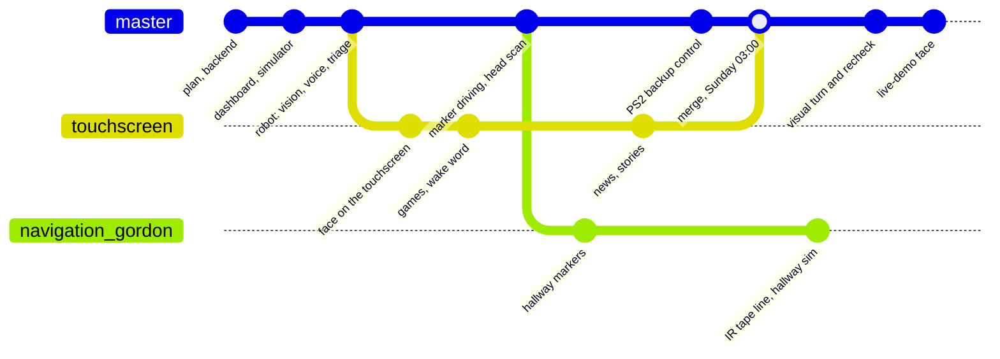

| Feature | Branch | State |
|---|---|---|
| Backend, dashboard, simulator | `master` | Merged and tested together |
| Calls, visits and triage on the robot | `master` | Merged. The end-to-end harness (real backend, fake Pi) passes 148 checks |
| **Personality and games**: the face, the touch games, the wake word, news and stories | `touchscreen` | Merged into `master` on Sunday at 03:00, but it runs as its own mode. `robot.sh` starts the voice only: no camera, no wheels |
| **Autonomous driving A**: camera head scan, visual turn and recheck, PS2 backup | `master` | `run_rover.sh` and `live-demo.sh` start it with vision, driving and the visit voice |
| **Autonomous driving B**: hallway IR tape line, face-height door markers, a 2D hallway simulation | `navigation_gordon` | Not merged. 4 commits ahead, 16 behind, and conflicts in 5 files, `navigator.py` among them |

Why it was hard:

- **Two navigators, one file.** Both driving approaches rewrote `rover/drive/navigator.py` and
  `config.py` from the same starting point, for different hallways. A searches with the camera head
  and turns in place. B follows a tape line and looks left and right at every door. That needs a
  decision or a mode switch, not a text merge.
- **One Pi with 2 GB.** The chat mode fits and the driving stack fits. All of it at once (YOLO,
  torch, the speech models, the face) does not fit comfortably, so the two launchers start
  different subsets.
- **Hardware came late.** Much of the robot code was written and tested against a `FakeCar` and a
  fake Pi before the robot was on the bench, so integration problems surfaced at the end.
- **We lost the Pi at 11 pm.** Its operating system got corrupted the night before the 9 am
  deadline, and part of the last night went to reflashing it and setting the stack up again.
  [More](#losing-the-pi-at-11-pm).

**How it ended.** The idea was one robot: a bell rings, the robot drives to the room and talks with
the resident, and a nurse follows it all on the dashboard. At the deadline we had those as working
pieces, not one product. The personality and games ran on the robot, the driving ran on the robot,
and the backend and dashboard ran against a simulated home, but they never ran together. Gordon
stayed up until the deadline trying to merge them, and the architectures were too far apart. With
the product not matching the idea yet and none of us having slept, we only got as far as
submitting to Devpost before we collapsed from exhaustion. Gordon tells the software side of the
weekend in [his post](https://lnkd.in/p/gvyxAF7g).

The lesson we are taking from it: **integrate on day one, not on the last night.**

---

## Status

<sub>Where each piece stood at the Cal Hacks deadline.</sub>

<table>
<tr><td><sub>Backend, dashboard, simulator</sub></td><td><sub>Complete</sub></td></tr>
<tr><td><sub>Robot logic tests (no hardware needed)</sub></td><td><sub>Passing</sub></td></tr>
<tr><td><sub>Vision and markers on the real Pi</sub></td><td><sub>Working</sub></td></tr>
<tr><td><sub>Voice, face, games and stories on the real Pi</sub></td><td><sub>Working, as their own mode (<a href="artifacts/hardware/media/bellhop-demo.mp4">demo</a>)</sub></td></tr>
<tr><td><sub>Marker driving on the real car</sub></td><td><sub>Working: follows a carried marker in the demo; turn direction and heading still being tuned</sub></td></tr>
<tr><td><sub>Chats compacted into a <code>memory.md</code></sub></td><td><sub>Shown in the demo; the code is not on a pushed branch</sub></td></tr>
<tr><td><sub>PS2 remote as backup driving</sub></td><td><sub>Working, deadman on R2</sub></td></tr>
<tr><td><sub>Local triage scorer</sub></td><td><sub>Built and measured, off by default</sub></td></tr>
<tr><td><sub>Physical call bell</sub></td><td><sub>Not built; calls come from the API</sub></td></tr>
<tr><td><sub>Bell to visit on the real robot, with the dashboard</sub></td><td><sub>Not shown by the deadline</sub></td></tr>
<tr><td><sub>Personality and driving in one robot</sub></td><td><sub>Not merged yet</sub></td></tr>
<tr><td><sub>Claude's 10 s waypoint loop</sub></td><td><sub>Designed, not running</sub></td></tr>
<tr><td><sub>Hallway navigator (B)</sub></td><td><sub>On its own branch</sub></td></tr>
<tr><td><sub>Mapping</sub></td><td><sub>None; the marker search is bounded at 45 s</sub></td></tr>
</table>

<sub>Gaps and handoffs in detail: <a href="artifacts/architecture/11-status.md"><code>11-status.md</code></a>.</sub>

---

## The build

<table>
<tr>
<td width="33%" valign="top">
<a href="artifacts/hardware/README.md">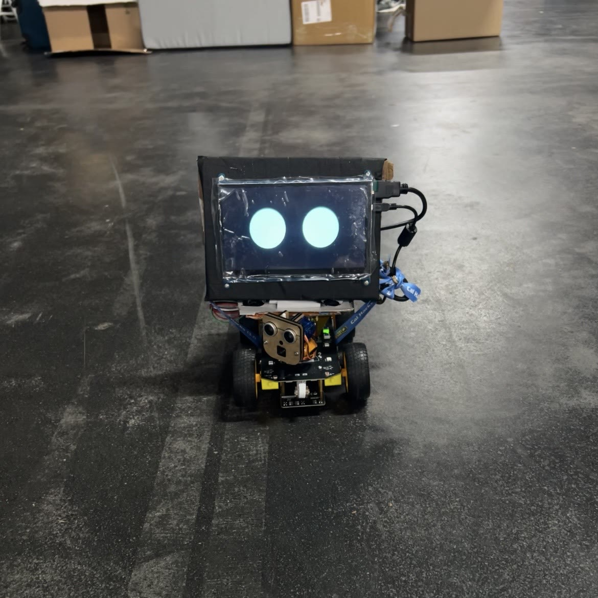</a>
<br><b><a href="artifacts/hardware/README.md">Hardware</a></b><br>
A Freenove 4WD kit rebuilt as a care robot: a camera and ultrasonic head, a touchscreen face, a
PS2 remote that stood in for the bell and drives the robot when autonomy fails, and the power and
pin problems that came with them.
</td>
<td width="33%" valign="top">
<a href="artifacts/components/ml.md">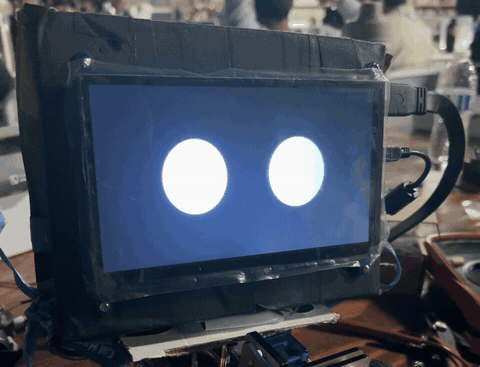</a>
<br><b><a href="artifacts/components/ml.md">Robot brain</a></b><br>
Vision, voice, games and triage on the Pi. Settings card, wire formats, and a troubleshooting
table built from what actually broke.
</td>
<td width="33%" valign="top">
<a href="#how-the-robot-finds-a-room">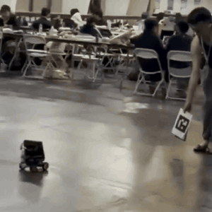</a>
<br><b><a href="#how-the-robot-finds-a-room">Navigation</a></b><br>
No map and no encoders: a printed marker on every door, a camera head that searches for it, and
camera-checked turn pulses until the robot faces the door.
</td>
</tr>
<tr>
<td width="33%" valign="top">
<a href="artifacts/components/backend.md">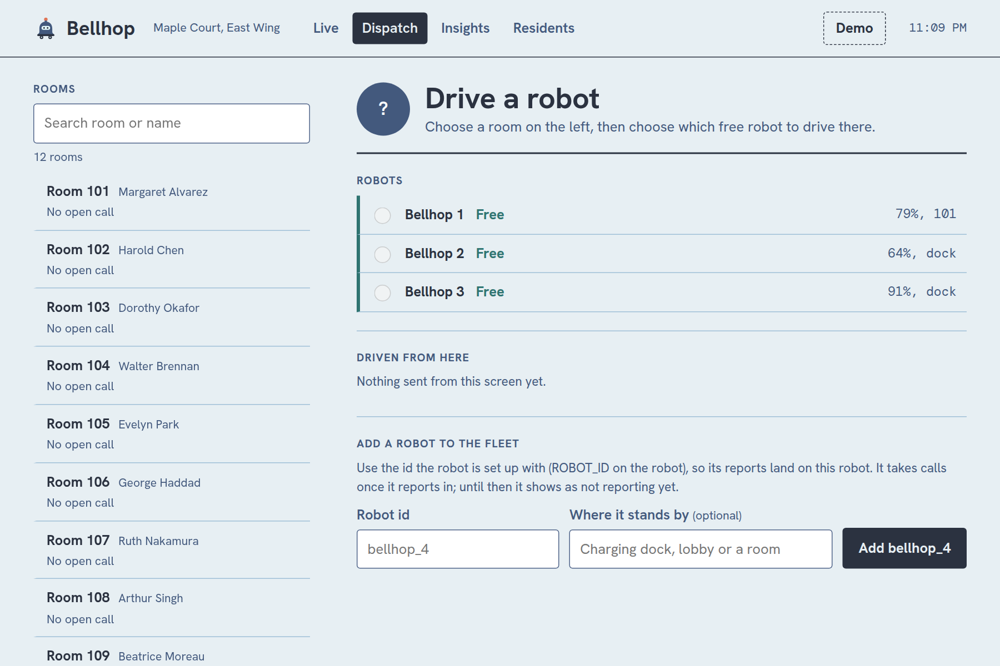</a>
<br><b><a href="artifacts/components/backend.md">Backend</a></b><br>
Call lifecycle, dispatch to the closest free robot, a triage guard, resident memory and live
events. 1,069 tests passing at the 24 Oct snapshot.
</td>
<td width="33%" valign="top">
<a href="frontend/">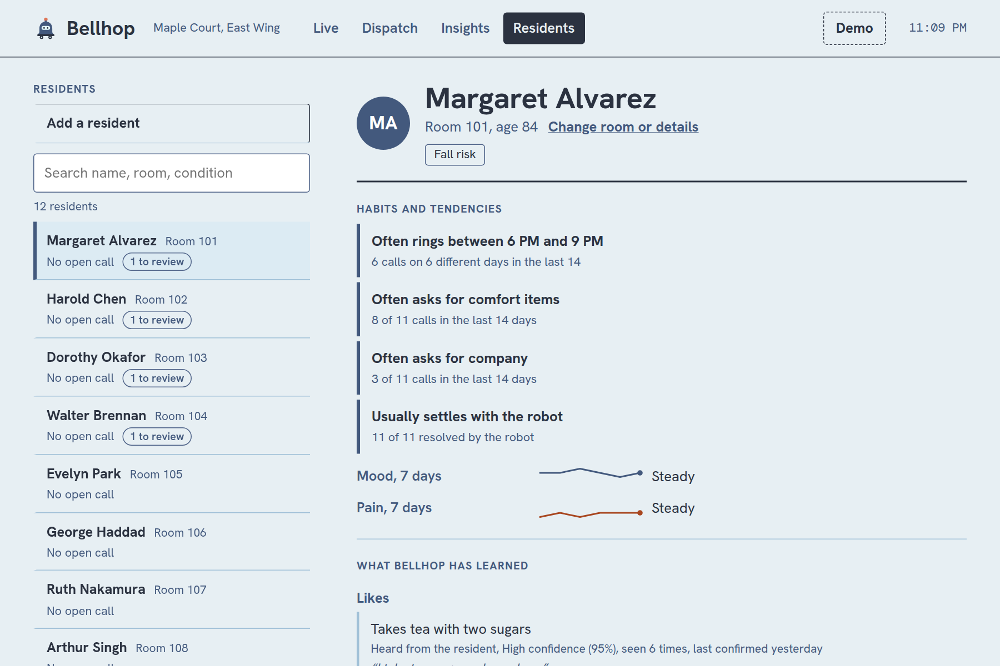</a>
<br><b><a href="frontend/">Nurse dashboard</a></b><br>
Large type, calm colours, urgency in words as well as colour. Each resident's habits, mood and
pain trends, and what the robot has learned about them, for a nurse to confirm.
</td>
<td width="33%" valign="top">
<a href="artifacts/architecture/13-research-policy-and-triage.md">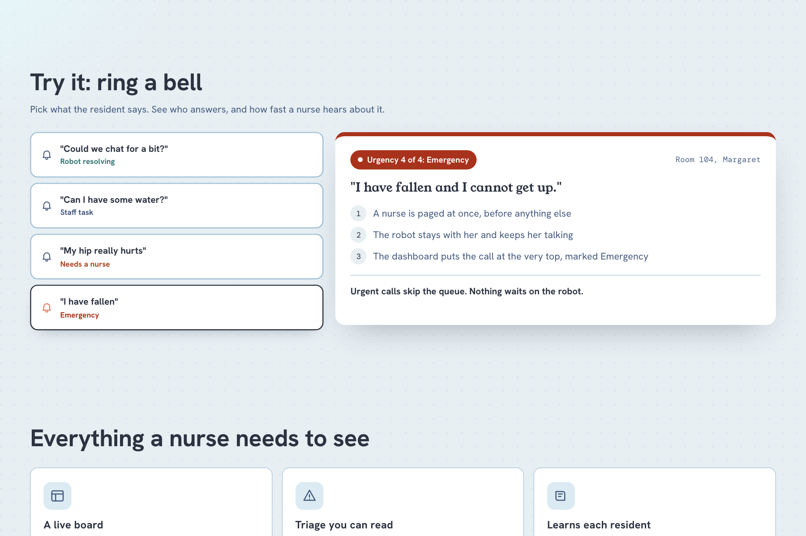</a>
<br><b><a href="artifacts/architecture/13-research-policy-and-triage.md">Triage</a></b><br>
Four urgency levels, a ratchet that never lowers a call, and a bias toward escalating whenever
the model is unsure.
</td>
</tr>
</table>

<sub>Safety: the wheels stop on their own when the backend stops sending commands, when the program
is shut down, or when the driver lets go of R2 on the PS2 remote, and an "emergency" light turns
itself off after 120 s. [Details](artifacts/hardware/README.md#safety).</sub>

> ### [Read the hardware build log](artifacts/hardware/README.md)
>
> The parts list, the problems we hit on the bench and how we got past them, the photos, and what
> the next version of the hardware should have.

---

## Repository layout

| Folder | What is in it |
| --- | --- |
| [`ml/`](ml) | The robot: vision, speech, triage, driving, the face and games on the Pi |
| [`backend/`](backend) | Python API: call lifecycle, dispatch, triage, memory learning, live events |
| [`frontend/`](frontend) | The nurse dashboard (Vite, React, TypeScript) |
| [`simulator/`](simulator) | Plays a fictional care home so you can demo without hardware |
| [`spacetimedb/`](spacetimedb) | Optional database module so data survives a restart |
| [`contracts/`](contracts) | The API contract and example payloads |
| [`artifacts/`](artifacts) | All documentation, plan and research |
| [`artifacts/hardware/`](artifacts/hardware) | The hardware build log, and its photos and clips in `media/` |
| [`artifacts/dashboard/`](artifacts/dashboard) | Screenshots of the nurse dashboard, taken from `scripts/dev.sh mock` |

## Quick start

You need [`uv`](https://docs.astral.sh/uv/) and Node 22.

```bash
cd frontend && npm install && cd ..
scripts/dev.sh mock     # backend, simulator and dashboard with an example home
scripts/dev.sh empty    # the same with an empty home, for the real robot
scripts/dev.sh demo     # an empty real home, plus a Demo button that switches to an example one
```

Open http://localhost:5173. For the robot itself, start with the
[robot guide](artifacts/components/ml.md).

## Documentation

All documentation lives in [`artifacts/`](artifacts).

- [Hardware build log](artifacts/hardware/README.md): parts, bench problems, photos, next version
- [Robot guide](artifacts/components/ml.md): setting up the Pi, settings card, troubleshooting
- [Setup guide](artifacts/setup.md): every service, from a fresh clone to a demo
- [Engineering overview](artifacts/overview.md): architecture, call lifecycle, decisions
- [Architecture notes](artifacts/architecture/README.md): module map, testing, status
- [Project plan and research](artifacts/docs-index.md), with [polished pages](artifacts/index.html)
- [API contract](artifacts/components/contracts.md)

---

## Why it runs on the robot

PROBLEM: Care-home Wi-Fi drops. A robot that freezes, or drives on, when the network stalls is
worse than no robot, and streaming every sound in a resident's room to the cloud is not
acceptable.

SOLUTION: Perception, speech detection, the voice, room finding and every safety stop run on the
Pi. The cloud handles only open conversation and the best speech recognition, each with a fallback
that leans toward a nurse.

---

## Team and credit

- **Jeremy Aidan Yu**: assembled the robot and did the electrical debugging. Helped shape the voice
  agent's state machine and the navigation's trajectory reorientation, and proposed the PS2 remote
  as the bell's stand-in and the backup driver. Wrote the
  [hardware build log](artifacts/hardware/README.md), added after the event.
- **Gordon Huynh**: led the embedded AI and ML side. Designed the navigation pipeline and built the
  voice agent, its personality, the touchscreen games, the stories and the news.
- **Aditya Tripuraneni**: extended the robot's architecture, built out the navigation, and built the
  backend.
- **Yash Patolia**: the nurse dashboard with SpacetimeDB, the simulator, and the Devpost and its
  [video](https://www.youtube.com/watch?v=vnsqGMfTnL8).

Roles as Gordon describes them in [his post](https://lnkd.in/p/gvyxAF7g).
The isometric sketch at the top was made with Claude.

Models and libraries keep their own licences; the Piper voice is non-commercial and YOLO is
AGPL-3.0. The full table is in the [robot guide](artifacts/components/ml.md#credits-and-licences).
Prototype only: no diagnosis, no real patient data.
