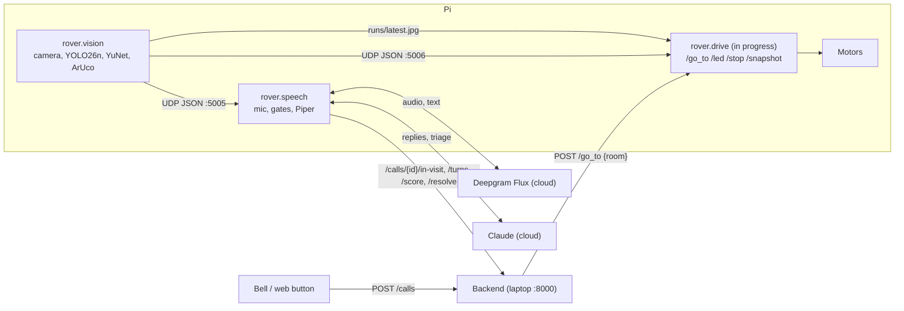

# Bellhop robot (ml/)

The code that runs on the robot (Freenove 4WD car, Raspberry Pi 5 2 GB, Camera Module 3, USB mic and speaker):

- **vision**: camera, person tracking (YOLO26n), faces (YuNet), door markers (ArUco)
- **voice**: mic, listen gates, Deepgram Flux speech-to-text, Claude replies, Piper voice "Poppy"
- **agent context**: persona, activity rules and tools for Claude (`pi/src/rover/agent/`)
- **triage**: scores each visit and posts it to the backend (`pi/src/rover/triage/`)

It talks to the team backend only through its HTTP API. Every command below says where it runs: **(Mac)** or **(Pi)**, and runs from `ml/pi/` (on the Pi: `~/ml/`) unless it says otherwise.

| Folder | What | Sent to the Pi |
| --- | --- | --- |
| `pi/` | everything the robot runs: `src/rover/`, `scripts/`, `pyproject.toml`, `uv.lock`, and `models/` once downloaded | yes, the whole folder |
| `tests/` | unit tests (pure logic, no hardware) | no |
| `dev/` | triage eval script and extra test phrasings | no |



## Quick start on the Mac

```
(Mac) cd calhacks-13/ml/pi
(Mac) uv sync
(Mac) cp .env.example .env                            # add keys; without them the code prints "fallback: <reason>"
(Mac) uv run python scripts/download_models.py        # YOLO26n -> NCNN, YuNet, Piper voice, Moonshine
(Mac) uv run python scripts/smoke.py                  # expect: SMOKE OK
```

Start the backend from its worktree (leave `BELLHOP_ROBOT_URL` unset on the Mac, so calls go to the seeded `robot_1`):

```
(Mac) cd ../../../calhacks-13-backend/backend && uv sync
(Mac) BELLHOP_SEED_DEMO=1 uv run uvicorn bellhop.api.main:app --host 0.0.0.0 --port 8000
```

Add `BELLHOP_STORE=spacetimedb` to keep calls across restarts (needs `spacetime start` and the module published; see the backend's docs).

Then, in two more terminals from `ml/pi/`:

```
(Mac) uv run python -m rover.vision --source 0 --show        # webcam window with boxes; q quits
(Mac) curl -s -X POST localhost:8000/calls -H 'Content-Type: application/json' -d '{"room":"12"}'
(Mac) uv run python -m rover.speech --call <id from the curl> --no-face
(Mac) curl -s localhost:8000/calls/<id>                      # transcript, urgency, summary
```

## Copy to the Pi

Needs 64-bit Raspberry Pi OS: **Trixie** (Python 3.13, the current default image) or **Bookworm** (Python 3.11), the camera connected, SSH and internet. Check with `python3 --version` on the Pi; `setup_pi.sh` stops on any other version. The Pi venv always uses the system Python (apt's picamera2 only works with it). On 3.13 the lock installs numpy 2.x, on 3.11 numpy 1.x (the pyproject markers choose). A 2 GB Pi is tight: see the memory note below. Only `ml/pi/` is sent; it lands as `~/ml` on the Pi. From `calhacks-13/`:

```
(Mac) rsync -av --exclude .venv --exclude .python-version --exclude runs --exclude __pycache__ --exclude .env ml/pi/ pi@<pi-host>:~/ml/
(Pi)  cd ~/ml && bash scripts/setup_pi.sh
```

- `rsync` also copies `models/`, so the NCNN folder exported on the Mac arrives with it. Run `download_models.py` on the Mac first.
- `scp -r ml/pi pi@<pi-host>:~/ml` works too (when `~/ml` doesn't exist yet), but it copies the Mac's `.venv` (large, useless on the Pi; setup rebuilds it) and the Mac's `.env`.
- Re-run the same `rsync` after every code change. `.env` is excluded so the Pi keeps its own.
- Replace `pi` with your Pi's username.
- `.python-version` is excluded because setup writes the Pi's system Python into it (the Mac's says 3.11). If it was overwritten, a bare `uv run` on a Trixie Pi rebuilds `.venv` without apt's picamera2: re-run `setup_pi.sh`, or use `uv run --python .venv/bin/python ...`. (`deploy/push.sh` has the same issue: add `--exclude '.python-version'` to its rsync.)
- Manual equivalent of steps 4 to 6 on the Pi: `uv venv --system-site-packages --python /usr/bin/python3 .venv && uv sync --frozen --python .venv/bin/python`. `uv sync` keeps `include-system-site-packages = true` on an existing venv. Without curl, `setup_pi.sh` installs uv with `python3 -m venv ~/.uvtool && ~/.uvtool/bin/pip install uv` and links it into `~/.local/bin`.
- Memory: setup warns when total RAM is under 3 GB. On a 2 GB Pi run `rover.drive` always, and start `rover.vision` and `rover.speech` one at a time (separate terminals), watching `free -m`; add swap if `uv sync` is killed.
- numpy: the venv's numpy shadows apt's (venv comes first on `sys.path`), so picamera2 runs against the numpy in `.venv`. On 3.13 that is numpy 2.x, which apt's Trixie picamera2 is built for; on 3.11 it is numpy 1.x, which Bookworm's picamera2 needs.
- GPIO: setup adds `GPIOZERO_PIN_FACTORY=lgpio` to `.env` (Pi 5). The systemd units read `/etc/bellhop/env`; put the same line there.

`setup_pi.sh` is safe to re-run. What it does and what success looks like:

| Step | What it does | Success looks like |
| --- | --- | --- |
| 1 | Checks the Pi is aarch64 with Python 3.11 or 3.13, pins `.python-version`, warns if RAM is under 3 GB | `ok: aarch64, system Python 3.13` |
| 2 | `apt-get install python3-picamera2 libportaudio2 libgl1 libglib2.0-0t64` (or `libglib2.0-0` on Bookworm), plus smbus, lgpio, gpiozero, spidev | no errors |
| 3 | Installs `uv` if missing | `success: uv 0.x` |
| 4 | Makes `.venv` with `--system-site-packages` (sees apt's picamera2) | `.venv/pyvenv.cfg` has `include-system-site-packages = true` |
| 5 | `uv sync --frozen` (CPU-only torch from the lock) | no errors |
| 6 | `download_models.py --skip-yolo`, then `smoke.py` | `models OK`, then `SMOKE OK` with a `picamera2` line and `throttled=0x0` |

Then check the hardware one piece at a time (stop `rover.vision` and Freenove's server first; only one program can use the camera):

```
(Pi) uv run python scripts/check_camera.py          # check_camera: OK ... (480, 640, 3) uint8
(Pi) uv run python -m sounddevice                    # list audio devices; put part of the names in .env
(Pi) uv run python scripts/check_level.py            # speech at 30 cm peaks around -12 to -6 dBFS
(Pi) uv run python scripts/check_marker.py --at 1.0  # marker held at 1.0 m -> MARKER_FOCAL_PX for config.py
(Pi) uv run python scripts/check_face.py --screen    # cyan eyes on the screen, prints ms a frame
```

**Face screen** (7" 1024x600 HDMI touchscreen, landscape). Plug it into the Pi 5's micro-HDMI 0 (next to USB-C; its own cable is full-size HDMI, so use a micro-HDMI adapter) and its touch USB into the Pi. On the desktop, double-click the **Bellhop** icon (`setup_pi.sh` puts it on the desktop and in the menu) to start the robot: the eyes fill the screen and it sleeps until someone says **"Hey Bellhop"**. Then it talks (mic, Flux or Moonshine, Claude, Piper) and plays games on touch. "Hey Bellhop, what games do you have?" answers the question straight away; "Hey Bellhop" alone gets a hello. No need to say the name again: it listens until 20 s of quiet (`CHAT_QUIET_S`) or goodbye, says "Just say hey Bellhop when you need me" and sleeps. It never sleeps while a game is open, and saying its name never closes a game. Saying "Bellhop" while it is still thinking stops that reply and answers the new words instead; while it speaks the mic is off, so it cannot hear itself. This is `rover.speech --chat`. A chat posts nothing to the backend, never triages, calls a nurse or drives. Asleep it also waits for bells as usual, and a bell rung during a chat ends it ("Sorry, someone has rung their bell") so the robot visits that call.

Asleep, no model is loaded for the wake word: the mic and the speech detector run, and a Deepgram Flux stream opens only while someone talks, closing after 8 s without speech (`WAKE_STREAM_IDLE_S`). So it needs Wi-Fi, and Deepgram time is used whenever people talk near it (a TV left on keeps the stream open). The words heard while asleep go to Deepgram but nowhere else. Check it alone with `(Mac/Pi) uv run python scripts/check_wake.py`. To close the robot, swipe down from the very top edge of the screen to at least halfway (or press q or Esc). The same from SSH or the Pi Connect remote shell:

```
(Pi) bash ~/ml/scripts/robot.sh open    # the robot, asleep, on the Pi's screen (wakes it if running)
(Pi) bash ~/ml/scripts/robot.sh words   # what each side says and wake/sleep, live (all: runs/robot.log)
(Pi) bash ~/ml/scripts/robot.sh close   # close the robot: no more chats or bells
```
 Without a desktop (SSH, the systemd units, console boot) the eyes draw straight into the console framebuffer instead:

```
(Pi) sudo systemctl set-default multi-user.target  # boot to the console: no desktop, no icon to click
(Pi) sudo systemctl set-default graphical.target   # boot to the desktop again (the default)
```

**Games** (bingo, tic-tac-toe, memory match). The greeting says the robot can play games; after that it only offers them when the resident asks. Claude asks whether they know the game (a "yes" is saved to memory as "Knows how to play bingo.", so it is not asked again), then `start_game` opens it on a "Touch and hold to start" screen. The resident holds for a second to begin; untouched for 30 s, it closes and the eyes come back. Bingo calls a number each time "Next number" is tapped, crosses it off the card if it is there, and strikes through a full line. The tic-tac-toe robot loses about 60% of games: it plays perfectly except for random slips, and tunes how often it slips after every game. A game redraws only when something changes, so one left alone costs no CPU.

```
(Mac) uv run python ../dev/play_games.py [--talk] [--voice]  # mouse = finger; keys 1-3 open a game
(Pi)  uv run python scripts/check_touch.py                   # corners read about (0, 0) and (1023, 599)
```

**News, trends, the web and stories.** Claude has four more tools:
- `news` and `trends` answer at once from `runs/news.json` and `runs/trends.json`. A background thread refreshes them through Apify: news hourly, Google Trends every 6 hours. Each starts straight away if its cache is missing or old. That costs a few cents a day; mock `--script` runs never spend it. `APIFY_TOKEN` goes in `.env`; without it both tools say so and Claude uses web search instead.
- `web_search` is Claude's own search, run by Anthropic inside the reply (the basic `web_search_20250305`: about 4 s, against 18 s for the newer version). It costs about 1 cent a search. The persona never searches health questions: it offers a nurse.
- `read_book` reads one of 12 classic short stories (`STORIES` in `rover/agent/books.py`; O. Henry, Wilde, Saki, Sherlock Holmes, Irving; 8 to 80 minutes), never a whole novel. Each is cut from its Project Gutenberg book between its own heading and the next story's. The book downloads once into `runs/books/`. The story is read 4 sentences at a time with a 2 s gap, when the mic can hear them. Any speech stops it, even from someone not facing the robot, since it may be a call for help. "Go on" makes Claude open it again. A bookmark per resident (`runs/books/bookmarks.json`) carries a story over to the next visit. After about 15 minutes with no word to the robot it stops ("I'll stop there for now"), and the visit ends as a quiet one would.

```
(Mac/Pi) uv run python scripts/check_feeds.py    # both Apify feeds once (about 2 cents), then FEEDS OK
(Mac/Pi) uv run python scripts/check_stories.py  # every story found in its book, then STORIES OK
```

The Pi 5 gives USB only 600 mA in total without a 5 A USB-C supply, and a battery never counts as one. The screen's backlight and speaker draw from that, so a screen powered from a Pi USB port can go dark for seconds when the robot talks. Power it from its own 5 V supply (a power bank or the battery's 5 V, into the screen's power-only port) and keep only the touch cable on the Pi. `(Pi) uv run python scripts/check_power.py` while the robot talks shows whether it is power or memory. Memory: `robot.sh` runs only the voice process (no camera, YOLO or torch); if the systemd units were enabled, `(Pi) sudo systemctl disable --now bellhop-vision bellhop-speech` keeps them from running beside it.

## Running on the Pi

Network: install Tailscale on the Pi and the backend laptop (`curl -fsSL https://tailscale.com/install.sh | sh`, then `sudo tailscale up`; read each IP with `tailscale ip -4`).

```
(Pi, terminal 1) cd ~/ml && uv run python -m rover.vision
(Pi, terminal 2) cd ~/ml && uv run python -m rover.speech
```

Without `--call`, the voice process polls `GET /calls` for a call assigned to `ROBOT_ID`.

| Setting (`.env`) | Mac | Pi |
| --- | --- | --- |
| `BELLHOP_API` | `http://127.0.0.1:8000` | `http://<laptop-tailscale-ip>:8000` |
| `PI_SERVER_URL` | unused | `http://127.0.0.1:<robot server port>` |
| `ROBOT_ID` | `robot_1` | `robot_1` |
| `DEEPGRAM_API_KEY`, `ANTHROPIC_API_KEY` | same keys | same keys |
| `MIC_NAME`, `SPEAKER_NAME` | empty (default device) | part of the USB device names (required: the default is HDMI) |
| `BELLHOP_API_KEY` | only if the backend sets one | same |
| `BELLHOP_LOCAL_HTTP_TIMEOUT_S`, `BELLHOP_BACKEND_HTTP_TIMEOUT_S` | 2 s, 5 s | same; keep the local drive server responsive while allowing a brief Tailscale/WSL stall |

### Optional Jev assessment and tone

Jev is deliberately off by default. Moonshine, Claude, Piper, the local urgency floor, marker
navigation and the manual controller all work without it. To enable its advisory triage and reply
tone choices on the Pi, add the sandbox key only to `~/ml/.env` (never commit it):

```bash
TYPESAFE_API_KEY=<your-key>
```

The adapter uses the existing HTTP client—there is no SDK or model download. `JEV_TIMEOUT_S`
(default `1.5`) bounds an individual request. The first spoken reply never waits for Jev's optional
tone; it uses Claude's tag when the background decision is not already ready. Network/API errors
and malformed answers are ignored. Claude remains the primary triage narrative; Jev can only add
an urgency escalation.
Set `TYPESAFE_API_KEY=` or remove it to disable Jev immediately.

On the backend laptop for the demo: `BELLHOP_ROBOT_URL=http://<pi-tailscale-ip>:<robot server port>`.

### Safe stationary conversation test

Use this before any drive test. It exercises the complete voice path—bell call, Moonshine
transcription, Claude reply, Piper playback and backend triage—while deliberately preventing all
drive commands. The backend must be started with `BELLHOP_ROBOT_URL` **unset** for this test.

On the Pi, first confirm that the configured backend answers. `API` is read from `.env`, so no
machine address is baked into code or the command:

```bash
cd ~/ml
API=$(sed -n 's/^BELLHOP_API=//p' .env | tail -n 1)
curl --max-time 5 -sS "$API/health"
```

Stop an existing speech listener before starting a manual one. This prevents two processes from
competing for the microphone:

```bash
sudo systemctl stop bellhop-speech 2>/dev/null || true
pkill -f '[r]over\.speech' 2>/dev/null || true
```

Then create one demo call and start the voice process. `--call` forces an immediate greeting for
that call, `--no-face` avoids requiring the camera during the audio test, and `--no-status` avoids
status polling. The temporary `PI_SERVER_URL` points to an unused local port only for this command;
it prevents the normal end-of-visit `/go_to` home command from reaching `rover.drive`.

```bash
CALL_ID=$(curl -fsS -X POST "$API/calls" \
  -H 'Content-Type: application/json' \
  -d '{"room":"12"}' | .venv/bin/python -c 'import json,sys; print(json.load(sys.stdin)["id"])')
echo "Call: $CALL_ID"
PI_SERVER_URL=http://127.0.0.1:9 .venv/bin/python -m rover.speech \
  --call "$CALL_ID" --room 12 --no-face --no-status
```

Wait for the greeting before speaking. Press `Ctrl-C` to stop the voice process. Restore the usual
`PI_SERVER_URL` from `.env` only when the drive safety checklist has passed and a physical drive
test is intended.

## Integration

**Vision message.** `rover.vision` sends one JSON per frame over UDP to `127.0.0.1:5005` (voice) and `127.0.0.1:5006` (driving):

```json
{
  "t": 1761300000.12, "fps": 12.3,
  "person": {"id": 4, "box": [x1, y1, x2, y2]},
  "face": {"box": [x, y, w, h], "score": 0.93, "facing": true, "width": 62.0},
  "markers": [{"id": 201, "room": "12", "distance_m": 1.42}]
}
```

- `person` and `face` are `null` when nothing is seen; `markers` is `[]`. A marker id missing from `MARKER_ROOMS` has `"room": null`.
- Boxes are pixels in the 640x480 frame. NaN distances are dropped before sending.
- Treat no message for 2 s (`VISION_STALE_S`) as "no vision": stop, don't guess.
- Read it: `sock = socket.socket(socket.AF_INET, socket.SOCK_DGRAM); sock.bind(("127.0.0.1", 5006)); json.loads(sock.recv(65535))`.

**Robot server (`rover.drive` on the Pi).**
- `POST /go_to {"room"}` must return 2xx at once and drive in the background. The backend waits 2 s; slower or non-2xx gives the call to a nurse only and the robot never sees it.
- `POST /led {"state"}` (`idle`, `listening`, `nurse_on_way`, `emergency`), `POST /stop`.
- A lit LED that no `/led` has refreshed for `LED_HOLD_S` (120 s) returns to `idle`; the speech process re-sends it while a visit is live and sets it idle (plus `/stop` if it died) when the visit ends. Only the backend sends `idle` otherwise, so this is what un-sticks the LED if the backend dies mid-visit.
- `GET /snapshot` also returns `power` (Pi throttle flags, `null` off the Pi) and `wifi_rssi_dbm`. Undervoltage now makes the status heartbeat report `fault`; earlier flags only warn in the log (`status.power`). `PUT /robots/{id}` still sends only `status`, `battery`, `room`.
- SIGTERM/SIGINT/SIGHUP on `rover.drive` stop the wheels, set the LED idle and exit 0 (`rover.safety`).
- `GET /snapshot` serves `~/ml/runs/latest.jpg`, which vision rewrites about once a second (atomic rename, never half a file).

**Optional manual controller backup.** `rover.drive --controller` reads the standard Linux
joystick device in `BELLHOP_MANUAL_DEVICE` (default `/dev/input/js0`), which is how most wired
and Bluetooth PS2 adapters appear on the Pi. It has no third-party controller-library dependency:
if the adapter is absent or its driver exposes a different interface, the server stays up and
manual input is unavailable rather than crashing. Check the actual device before configuring it:

```bash
ls -l /dev/input/js*
```

Movement requires continuously holding the configured deadman button. Releasing it, unplugging
the device, ending the process, or missing the short refresh timeout stops the motors. Manual input
cancels marker navigation, and an autonomous dispatch received while manual input is active is
ignored; `POST /stop`, process signals, and the motor watchdog still stop immediately. Axis/button
numbers, duty cap, and timeout are deployment settings in `.env` (`BELLHOP_MANUAL_*`), not room or
controller-model hardcodes. Verify the mapping with wheels raised before any floor test.

**Rooms.** Printed markers use `DICT_4X4_250` (15 cm). Configure the venue mapping in the Pi's uncommitted `.env`, for example `BELLHOP_MARKER_ROOMS={"210":"12"}` when physical marker 210 is the backend's room 12. Numeric targets such as `210` address that marker directly; no room-to-marker mapping is embedded in code. Keep the backend resident room, bell button and this deployment mapping aligned.

**Head scan.** While a requested marker is missing, the rover keeps its wheels stopped and sweeps the camera head through the Cartesian product of `BELLHOP_HEAD_SCAN_PANS` and `BELLHOP_HEAD_SCAN_TILTS`, dwelling on every pose including the last. The Freenove servo client maps selectors 0/1 to PCA9685 channels 8/9 (pan/tilt) and applies a +10-degree calibration offset, so autonomous scans are restricted to the stock-safe pan range 30 to 150 degrees (90 is straight ahead, 30 looks left, 150 right; `BELLHOP_HEAD_PAN_RIGHT_SIGN=-1` if yours is reversed); tilt is restricted to 80 to 180 degrees to clear the chassis (higher looks up). The default sweep is pan 30/90/150 at tilt 80/90/110. Tune the dwell in `.env`, then first run `python -m rover.drive --head-test` with the wheels clear of the floor. A missing marker never makes the rover drive blindly.

**The ultrasonic rides on the camera head.** It pans and tilts with the camera, so the head is level (`BELLHOP_TILT_DRIVE`) for every forward step that is not steering at a marker, and the drive waits for the head to settle before moving. Steering at a marker uses `BELLHOP_TILT_APPROACH`: tilt it up for face-height door markers, or the marker leaves the top of the frame inside about 2.5 m. The ultrasonic stops the approach too, but tilted up it sees walls, doors and standing people, not low obstacles.

**Offline marker mode.** ArUco room detection does not need YOLO or YuNet. If either local person/face model is absent, `rover.vision` logs that those optional detections are disabled and continues with camera, markers, UDP and snapshots; it never starts an implicit model download.

**Active marker search.** When its target is outside the first camera view, the rover stops its wheels for a full two-axis head scan, turns incrementally in place (`BELLHOP_SEARCH_TURNS_PER_LAP` turns), and then takes a short ultrasonic-guarded forward frontier step before scanning again. With the defaults (9 scan poses, 8 turns) the first step comes after about 50 s, past the 45 s `BELLHOP_SEARCH_MAX_S` cap, so use fewer poses or turns. A target seen while the head is panned to a side first re-centres the camera, then turns the body toward that side until the target is in front, then the rover steers at it; frames from the first `BELLHOP_HEAD_RECENTER_SETTLE_S` after any head move (including the first, since the head's starting pose is unknown) are never steered on. Every forward step and approach requires a finite, clear ultrasonic reading; no reading counts as blocked. The search stops without claiming arrival when its cap is reached (`failed()`). This is bounded exploration, not a surveyed-map/SLAM guarantee: the rover has no wheel encoders, IMU or lidar.

**Hallway line mode.** For a hallway with door-frame markers on both sides, lay dark tape (about 2 cm, on a light floor) down the middle and a cross strip at the far end. With `BELLHOP_LINE_FOLLOW=1` and `BELLHOP_SEARCH_TURNS_PER_LAP=0` the rover never spins: it follows the tape with Freenove's three IR line sensors for one `BELLHOP_SEARCH_ADVANCE_S` step (head level, ultrasonic guarding), stops, looks left and right at face height, and repeats. Every door is checked; markers other than the target are ignored. Tape lost (reading 0) or the end strip (7) stops the step and prints a `fallback:` line. Markers mounted flat on the frame face across the hallway, so a side view reads one from about 1.2 m before the rover is level with it; keep steps around 0.3 m so each marker gets several looks. Starting values are in `pi/.env.example`. Check the sensors first with Freenove's own `python infrared.py` over the tape: centred prints 2, tape under the left sensor 4, under the right 1.

**One-command live stack.** From the laptop, set the Pi's Tailscale SSH host and IP once per venue, then run `BELLHOP_PI_HOST=pi@<pi-ip> BELLHOP_PI_IP=<pi-ip> bash scripts/live-demo.sh`. It syncs the Pi source without touching its `.env`, models or venv; opens a local SSH tunnel to the Pi drive server, starts the seeded backend through that tunnel, starts the dashboard when its dependencies are installed, then runs Pi camera, drive and speech in one SSH session. This avoids venue/WSL filtering of direct TCP to the Pi. Its dashboard uses API mode `auto`: a laptop browser uses loopback, while a touchscreen that opens `http://<laptop-tailscale-ip>:5173` uses that same Tailscale host for the backend. Set `BELLHOP_DASHBOARD_API_URL=http://<reachable-laptop-ip>:8000` only when the automatic address is not right for the venue. If Jev has no key in the Pi's `.env`, it prompts securely for an in-memory key once; Enter disables Jev for that run. Ctrl-C stops the whole stack safely. On the Pi alone, `bash ~/ml/scripts/run_rover.sh` starts those three rover components in one terminal.

**Password-free SSH.** Do not store the Pi password in the repository or a shell command. Once,
create a dedicated key on the laptop and authorize its public half on the Pi:
`ssh-keygen -t ed25519 -f ~/.ssh/bellhop_pi_ed25519 -N "" -C bellhop-demo`, then
`ssh-copy-id -i ~/.ssh/bellhop_pi_ed25519.pub pi@<pi-ip>`. Launch with
`BELLHOP_PI_SSH_KEY="$(realpath ~/.ssh/bellhop_pi_ed25519)"`; the live script applies it to
rsync, its tunnel and its remote rover command.

**Voice reliability.** Neither the microphone callback nor the Flux sender can block audio
capture on a weak cloud connection. The microphone queue is bounded and retains the newest
audio, logging dropped blocks (`MIC_QUEUE_BLOCKS=64`, about two seconds; tune only after a
real microphone test). Flux sends from its own thread; once `FLUX_BACKLOG_S` (4 s) of audio
is queued behind, the stream reports one Error instead of answering a stale sentence. Long visits also retain a
bounded earlier-conversation reminder instead of abruptly losing prior context.

**Visit flow** (`rover.speech`):
1. Find the call: `--call <id>`, or the newest call for `ROBOT_ID` in `assigned` / `robot_en_route`.
2. Start the visit when the room's marker is within `ARRIVE_DISTANCE_M` (straight-line), a facing face is seen for 1 s, or 60 s pass: `POST /calls/{id}/in-visit` (409 "already in visit" counts as success).
3. Each resident turn: `POST /turns {"speaker": "resident"}`, triage in the background, the reply is spoken and posted as `{"speaker": "robot"}`.
4. End on goodbye, "not now" or 60 s of quiet. **Urgency 1-2**: `POST /resolve {"by_robot": true}`. **Urgency 3-4**: stay and keep talking until the call shows `nurse_acked` (or Enter is pressed), then `POST /resolve {"by_robot": false}`. Without a resolve the robot stays busy and gets no more calls.

**Triage contract.** `POST /calls/{id}/score {"urgency": 1-4, "category", "summary", "confidence": 0-1}`; 1 chat, 2 routine, 3 nurse soon, 4 emergency. Confidence below 0.6 bumps urgency up one level; a keyword floor can only raise it; urgency never goes down on a call. If the models fail: `POST /calls/{id}/triage-failed` (backend defaults to 3). The summary is one plain line for the nurse, no diagnosis. Evaluate against the labelled set (under-escalations are what matter):

```
(Mac) uv run python ../dev/eval_triage.py     # default: GET /labelled-examples (BELLHOP_API, BELLHOP_API_KEY) + dev/hard_cases.jsonl; pass JSONL files to use those instead; --mock runs offline with a fake triager (CI)
```

Full API: `artifacts/components/contracts.md` and `contracts/openapi.json`.

## Settings card

All thresholds live in `pi/src/rover/config.py`. These are start values: tune on site and change them there, nowhere else.

| Setting | Start value | What it does |
| --- | --- | --- |
| `LENS_POSITION`, `SHUTTER_US`, `ANALOGUE_GAIN` | 0.7, 8000, 4.0 | Locked focus (1 / metres) and exposure; short shutter cuts blur while turning |
| `YOLO_IMGSZ`, `YOLO_CONF` | 320, 0.4 | Person model input size (must match the export) and confidence |
| `COAST_S` | 2.0 | Keep the last target this long after it disappears |
| `FACE_SCORE`, `FACE_SEEN_OF`, `FACE_MIN_WIDTH_PX` | 0.9, (3, 5), 40 | Face must score 0.9+, be seen in 3 of 5 frames, and be wide enough (near) |
| `MARKER_FOCAL_PX`, `ARRIVE_DISTANCE_M` | 470, 1.0 | Marker distance calibration and "arrived" distance. It is the straight-line camera-to-marker distance (from the marker's longest side), so a face-height marker never reads below about 1.3 m: set `BELLHOP_ARRIVE_DISTANCE_M` to about 1.6 there |
| `MARKER_ROOMS` | {201: "12", 202: "14", 203: "lobby"} | Marker id to backend room |
| `SILERO_THRESHOLD`, `LOUDNESS_MARGIN_DB` | 0.5, 10 dB | Speech detector, and how far above the room's noise floor speech must be |
| `ECHO_TAIL_S` | 0.3 | Mic stays muted this long after Poppy stops |
| `EOT_THRESHOLD`, `EAGER_EOT_THRESHOLD`, `EOT_TIMEOUT_MS` | 0.8, 0.5, 3000 | Flux end-of-turn settings |
| `FLUX_TURN_LIMIT_S` | 5.0 | No Flux result this long after speech -> Moonshine offline |
| `BRAIN_MODEL`, `TRIAGE_MODEL` | Claude Sonnet, Claude Haiku | Reply model and triage model |
| `FIRST_TEXT_TIMEOUT_S`, `TRIAGE_TIMEOUT_S` | 6.0, 6.0 | Fallback line / triage give-up times (Claude gets one retry inside the 6 s; `TRIAGE_ATTEMPT_S` is one call) |
| `MIC_QUEUE_BLOCKS` | 64 | Bounded capture buffer; newest audio wins if the Pi falls behind |
| `HISTORY_EXCHANGES`, `HISTORY_CONTEXT_CHARS` | 20, 1200 | Full recent exchanges plus a bounded deterministic reminder of earlier visit context |
| `LOCAL_ONLY_CONFIDENCE` | 0.5 | Confidence sent when the optional offline scorer is the only source: bumps urgency one level |
| `VISIT_QUIET_END_S`, `VISIT_START_FALLBACK_S` | 60, 60 | End a quiet visit; start a visit without marker or face |
| `CHAT_QUIET_S`, `WAKE_STREAM_IDLE_S` | 20, 8 | A chat sleeps after this much quiet (never mid-game); asleep, the wake word's Flux stream closes after this much quiet |
| `PIPER_SPEAKER_ID`, `TONES`, `MAX_PITCH` | 3 (Poppy), table, 0.03 | Voice; speed and expressiveness per tone tag, with only a small pitch nudge |
| `VOICE_PITCH` (`.env`) | 0 | The whole voice higher or lower, e.g. -0.03 if it still sounds high |
| `EYES_FLIP`, `EYES_RGB`, `EYES_FPS` | off, cyan, 20 | Eyes on the HDMI screen (`rover/eyes.py`): upside-down mount, colour, frame rate. Check: `scripts/check_face.py [--screen]` |
| `GAME_HOLD_S`, `GAME_INTRO_TIMEOUT_S` | 1.0, 30 | Hold this long on a game's start screen to begin; untouched this long, it closes |
| `TICTACTOE_TARGET_LOSS`, `TICTACTOE_SLIP_STEP` | 0.6, 0.10 | Share of games the robot loses; how fast it adjusts its slips to get there |
| `EYES_MOOD_HOLD_S` | 3.0 | The reply's tone tag stays on the eyes this long after its last sentence |
| `FEEDS`, `APIFY_MAX_CHARGE_USD`, `FEED_RETRY_S` | news 1 h, trends 6 h; $0.05; 600 s | Apify actors, inputs and refresh times; the most one run may charge; the wait after a failed run |
| `WEB_SEARCH_TOOL`, `WEB_SEARCH_MAX_USES` | basic, 2 | Claude's search version (the basic one is 4x faster) and searches per reply |
| `READ_CHUNK_SENTENCES`, `READ_GAP_S`, `READ_MAX_PARTS` | 4, 2.0, 40 | A story is read this many sentences at a time, with this gap (the mic hears them), and stops after this many parts with no word to the robot |

## Local triage scorer (optional, offline, raise only)

`pi/src/rover/triage/local.py` embeds each resident line with a small ONNX model (fastembed,
`BAAI/bge-small-en-v1.5`, about 6 ms per visit on a laptop CPU) and scores it with a 6.5 KB linear
head (`pi/src/rover/triage/local_head.npz`, numpy only, committed). `triage()` lets it only RAISE
the urgency (never lower it), and only when its confidence is at least `LOCAL_MIN_CONFIDENCE`
(0.5). If the head or the embedding model is missing it returns None and nothing changes.

It is OFF by default (`LOCAL_TRIAGE=1` turns it on). See the numbers below for why.

```
(Pi or Mac) cd ml/pi && uv run python -m rover.triage.local     # one-time: fetch the embedding model into pi/models/embed
(Pi)        LOCAL_TRIAGE=1 uv run python -m rover.speech
```

Training is dev only and never shipped (extra deps live in the `train` uv group):

```
(Mac) cd ml/pi && uv sync --group train
(Mac) uv run python ../dev/train/collect.py hf            # Apache-2.0 chat sentences (empathetic_dialogues_llm)
(Mac) uv run python ../dev/train/collect.py apify         # public subreddit posts, about $2 (APIFY_TOKEN in dev/.env)
(Mac) uv run python ../dev/train/prepare.py sample --source reddit --n 200 --kind health --out r5
(Mac) uv run python ../dev/train/prepare.py label-claude --batch r5   # needs ANTHROPIC_API_KEY; or write data/labels/r5.txt by hand ("id 1-4" per line)
(Mac) uv run python ../dev/train/prepare.py build         # data/train.jsonl and the held-out data/eval.jsonl
(Mac) uv run python ../dev/train/train.py --compare       # out-of-fold comparison of embedding models
(Mac) uv run python ../dev/train/train.py --model BAAI/bge-small-en-v1.5 --c 4   # writes local_head.npz
(Mac) uv run python ../dev/train/evaluate.py [--claude] [--min-confidence 0.6]
```

`dev/train/data/` (collected text, labels, embedding cache) is git-ignored. The eval set is
`hard_cases.jsonl`, the backend labelled cases and a 100 line hand-verified sample (`labels/verify.txt`);
`build` removes any training text that equals or nearly equals an eval text, and `train.py` never reads
the eval file. The logit shifts that favour urgency 3 and 4 are tuned on out-of-fold predictions of the
training data, not on the eval set. `dev/train/synthetic_utterances.tsv` holds the hand-written spoken-style
training lines. Results of the latest run: see `dev/train/RESULTS.txt`.

## Tests

```
(Mac) uv run pytest                              # runs ../tests: pure logic, no camera, mic, network or keys
(Mac) uv run ruff check src scripts ../tests ../dev
```

## Troubleshooting

Work from the bottom layer up.

| Layer | Symptom | Check | Fix |
| --- | --- | --- | --- |
| Pi/Python | `setup_pi.sh` stops at step 1 | `/usr/bin/python3 --version` | Flash 64-bit Raspberry Pi OS (Trixie, Python 3.13, or Bookworm, Python 3.11) |
| Pi/Python | `externally-managed-environment` | Did you run plain `pip`? | Use `uv run ...`; never pip |
| Pi/Python | `ValueError: numpy.dtype size changed` on `import picamera2` | numpy line in `scripts/smoke.py` | numpy 1.x on Python 3.11 (Bookworm); on 3.13 it must be 2.x. Fix: `uv sync --frozen --python .venv/bin/python` |
| Pi/Python | `Killed` in the terminal | `free -m`, swap used in `smoke.py` | Out of memory: close other programs; one vision and one voice process only |
| Pi/Python | Low fps, `throttled` not `0x0` | `vcgencmd get_throttled`, `vcgencmd measure_temp` | Official PSU or stronger battery; airflow |
| Pi/Python | Low fps, `throttled` is `0x0` | First vision line prints `OMP_NUM_THREADS=` | Try 1-3 via `config.VISION_OMP_THREADS` (or `OMP_NUM_THREADS=` before `uv run`) |
| Pi/Python | `ImportError: libGL.so.1` on `import cv2` | `dpkg -l libgl1` | `sudo apt install libgl1 libglib2.0-0` (setup does this) |
| Pi/Python | `rsync: command not found` | `which rsync` on both machines | `sudo apt install rsync` on the Pi |
| Face | `start_game` says the screen is not available | Log line `fallback: no touch panel`; `check_touch.py` | Plug in the screen's touch USB cable; the `pi` user needs the `input` group (`groups`) |
| Face | Bellhop icon or `robot.sh open` shows nothing | `tail ~/ml/runs/robot.log` | "already running": stop the other one (`sudo systemctl stop bellhop-speech`); a Python error: fix it, often a missing key in `~/ml/.env` |
| Face | The screen goes dark for a few seconds when the robot starts talking (then a purple frame, then the face) | `grep 'speaker awake' ~/ml/runs/robot.log` ("keeping the speaker awake" is good; a `fallback:` line says why not); `uv run python scripts/check_power.py` while it talks; `dmesg \| grep -iE 'hdmi\|over-current'` right after | Waking the screen's sleeping HDMI speaker makes it re-sync: keep `AUDIO_KEEPALIVE=1` (the default; once at startup is expected). `fallback: the speaker plays one sound at a time`: a raw USB speaker, so it can't be kept awake (use the PipeWire default). "undervoltage YES" or 5 V below 4.8 V: the screen draws from the Pi's USB, so power it from its own supply (see Face screen) |
| Face | A game opens but touching never starts it, or taps in a game do nothing | `robot.sh words` (shows `fallback:`, `games: ... opened/closed`, `brain: tool` lines); `uv run python scripts/check_touch.py` (robot closed) | `fallback: touch panel lost`: the panel dropped off USB (power); it is found again by itself. `check_touch.py` names no panel: replug the touch cable. Corners far from (0, 0) and (1023, 599): the taps miss the squares, so report the numbers |
| Voice | It stops answering after a while | `robot.sh words` | `wake: asleep`: it fell asleep after 20 s without speech, so say "Hey Bellhop". `fallback: the speaker stopped playing`: the speaker (often the screen's HDMI audio) dropped out; it carries on. `fallback: Flux stopped (Flux send fell 4 s behind)`: the Wi-Fi stalled, so Moonshine answers for the rest of the chat (slower). None of these: copy `~/ml/runs/robot.log` |
| Tools | It says the news or trends are "not available" or "still fetching" | `robot.sh words`: `fallback: no APIFY_TOKEN` or `fallback: news refresh failed (...)`; `uv run python scripts/check_feeds.py` | No token: add `APIFY_TOKEN` to `~/ml/.env`. `Apify answered 401`: wrong token; `402`: the Apify account is out of credit. "Still fetching" just after start-up is normal: a news run takes about a minute |
| Tools | A story is "could not be opened" | `robot.sh words`: `fallback: '<title>' is not in Gutenberg book <n>'s text`; `uv run python scripts/check_stories.py` | Gutenberg changed that book's text: fix the story's `start` or `end` heading in `STORIES`. `the story library could not be reached`: no internet; a book read once is kept in `runs/books/` |
| Tools | The story never stops | Speak in the 2 s gap between parts: the mic is off while it reads | Saying "Bellhop" while it reads stops it at once. It also stops by itself after `READ_MAX_PARTS` parts with no word |
| Voice | It answers bits of a sentence one by one, or says sorry for (and redoes) something it already did | `robot.sh words`: several `resident:` lines in a row, repeated `brain: tool end_game` | Fixed: speech that piles up before or behind a reply is answered once (`visit: more speech is waiting`), and its tool calls are listed in its prompt. Still repeating: copy `~/ml/runs/robot.log` |
| Voice | "Hey Bellhop" does nothing | `robot.sh words` shows `wake: asleep`; `scripts/check_wake.py` | No `wake:` line: started without `--chat`. A `fallback: no DEEPGRAM_API_KEY` or Flux line: fix the key or Wi-Fi (`robot.sh open` still wakes it) |
| Face | Started over SSH or systemd, the screen shows the desktop | `systemctl is-active display-manager` | The desktop hides the framebuffer: use the Bellhop icon, or `sudo systemctl stop display-manager` |
| Camera | `IndexError` from `Picamera2()` | `rpicam-hello -n --list-cameras` shows `imx708` | Reseat the ribbon cable |
| Camera | Camera busy / no frames | `ps aux \| grep -i -E "freenove\|rpicam\|python"` | Stop the other camera user (Freenove server, `rpicam-*`, a check script) |
| Camera | Colours swapped (blue faces) | `check_camera.py` image | Camera must use `RGB888` (BGR order) |
| Camera | Blurry or dark | `check_camera.py` brightness | Tune `LENS_POSITION`, `SHUTTER_US`, `ANALOGUE_GAIN` |
| Models | `fallback: ... yolo26n_ncnn_model missing` | `ls models/yolo26n_ncnn_model` | (Mac) `scp -r models/yolo26n_ncnn_model pi@<pi>:~/ml/models/` |
| Models | No people found | `smoke.py` imgsz check | NCNN must be exported at `YOLO_IMGSZ`; re-export on the Mac |
| Models | No faces | Person close enough? `FACE_MIN_WIDTH_PX` | Move closer, check light; tune `FACE_MIN_WIDTH_PX` |
| Models | No markers | Printed dictionary and ids | Must be `DICT_4X4_250`, ids 201-210, with a white border |
| Drive | Never arrives at a face-height door marker: creeps up, loses it, searches | `check_marker.py` distance at the parking spot never goes below about 1.3 m | Set `BELLHOP_ARRIVE_DISTANCE_M` to that reading (about 1.6) and `BELLHOP_TILT_APPROACH` (about 120) so the marker stays in frame |
| Drive | Marker search never moves forward, then `timed out` | `drive.log`: only scans and turns | Scan poses x turns per lap take longer than `BELLHOP_SEARCH_MAX_S`; in a hallway use `BELLHOP_SEARCH_TURNS_PER_LAP=0` and pans `30,150` |
| Drive | Turns away from a marker it saw to the side | `--head-test`: does pan 30 look left? | Set `BELLHOP_HEAD_PAN_RIGHT_SIGN=-1` |
| Drive | `fallback: line sensors read 0` in hallway mode | Freenove `python infrared.py` over the tape (centred prints 2) | Dark tape on a light floor, about 2 cm wide; start the rover centred on it |
| Mic/audio | `PortAudio library not found` | `dpkg -l libportaudio2` | `sudo apt install libportaudio2` |
| Mic/audio | Garbled transcripts | `check_level.py` peak | Mic closer (USB extension), away from fan and speaker |
| Mic/audio | Wrong mic or speaker | `uv run python -m sounddevice` | Set `MIC_NAME` / `SPEAKER_NAME` in `.env` |
| Mic/audio | `mic: cannot open ... Invalid sample rate`, visit ends with "can't hear" | Device list shows `(hw:N,0)`, not `(plughw:N,0)` | `PA_ALSA_PLUGHW` must be `1` (`config.py` sets it); don't set it to 0 in `.env` |
| Mic/audio | Robot answers itself | Transcript matches its last reply | Speaker away from mic; raise `ECHO_TAIL_S` |
| Flux | `fallback: no DEEPGRAM_API_KEY` | `.env` | Add the key (no spaces around `=`) |
| Flux | HTTP 401 / 402 | Deepgram console | 401 bad key, 402 no credit |
| Flux | Slow or no turns, then Moonshine | Network; `FLUX_TURN_LIMIT_S` | Check Wi-Fi; Moonshine covers it offline |
| Claude | Fallback line spoken | The printed `fallback:` reason | Add `ANTHROPIC_API_KEY`; check network |
| Claude | HTTP 400 | Request sends `temperature` or prefill? | Remove them; current models reject both |
| Backend | `backend ... unreachable` in `smoke.py` | `curl http://<laptop-ip>:8000/health` | Backend started with `--host 0.0.0.0`; `tailscale status`; `BELLHOP_API` |
| Backend | Robot never gets the call | `GET /calls/<id>`: `robot_id` null | `/go_to` must answer 2xx within 2 s; check `BELLHOP_ROBOT_URL` |
| Backend | 401 on every call | Backend has `BELLHOP_API_KEY` set | Set the same `BELLHOP_API_KEY` in the Pi's `.env` |
| Backend | Robot stuck busy | `GET /robots` | The visit must end with `/resolve`; resolve the call by hand |

## Credits and licences

| Part | Licence |
| --- | --- |
| Piper voice `en_GB-semaine-medium` (rhasspy/piper-voices) | CC BY-NC-SA 4.0 (non-commercial) |
| `piper-tts` (OHF-Voice/piper1-gpl) | GPL-3.0 |
| `ultralytics` and YOLO26n weights | AGPL-3.0 |
| YuNet face detector (opencv_zoo) | MIT |
| Moonshine English model (moonshine-ai) | MIT |
| Silero VAD via `pysilero-vad` | MIT |
| Freenove 4WD car drivers (if used) | CC BY-NC-SA 3.0 |
| Short story texts (Project Gutenberg) | Public domain in the US; only the story text between Gutenberg's markers is read, never redistributed |

Cloud services: Deepgram Flux, Claude (Anthropic, including its web search) and Apify (news and Google Trends). Prototype only: no diagnosis, no real patient data.
