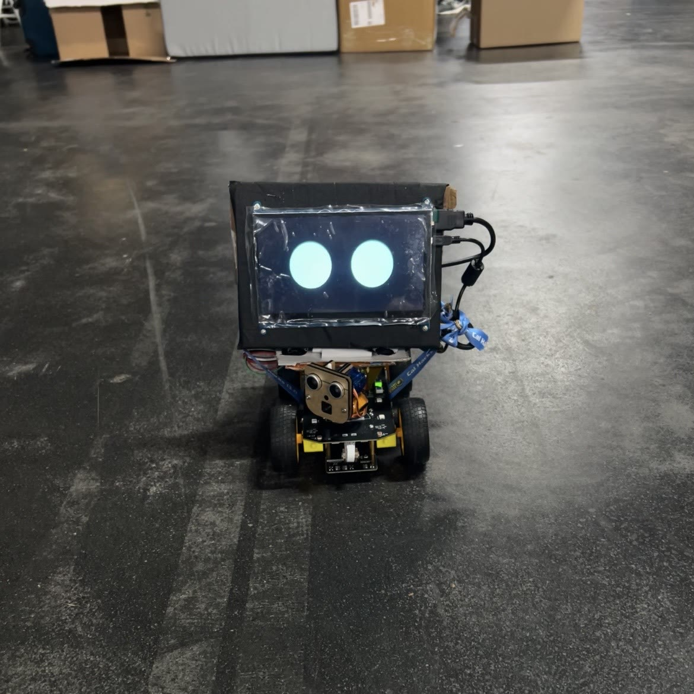
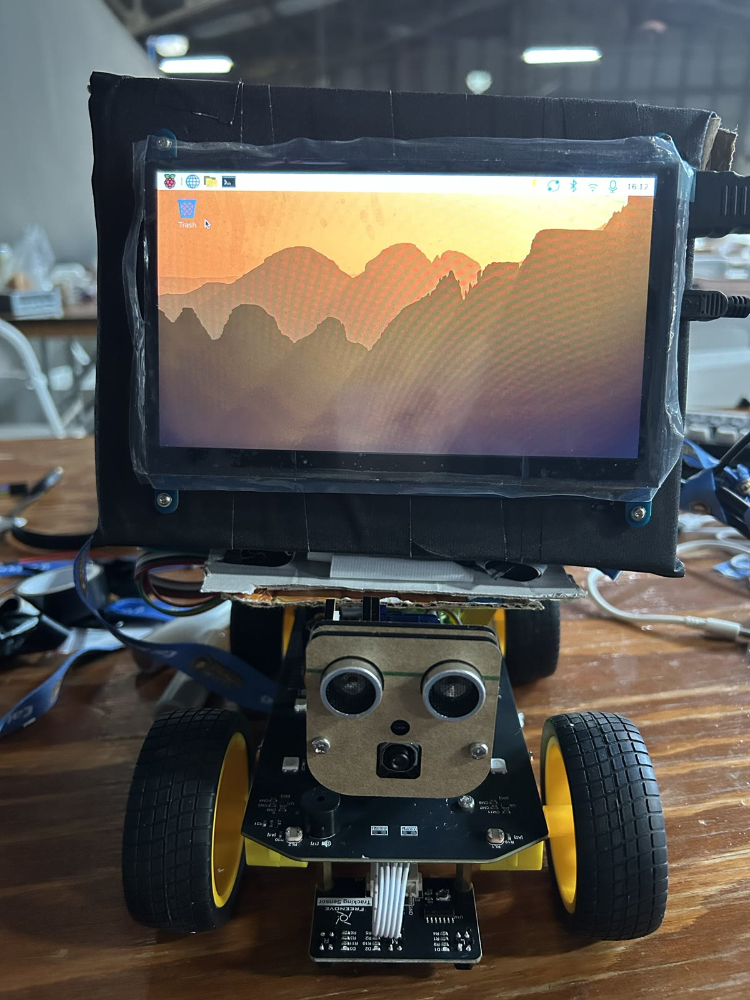
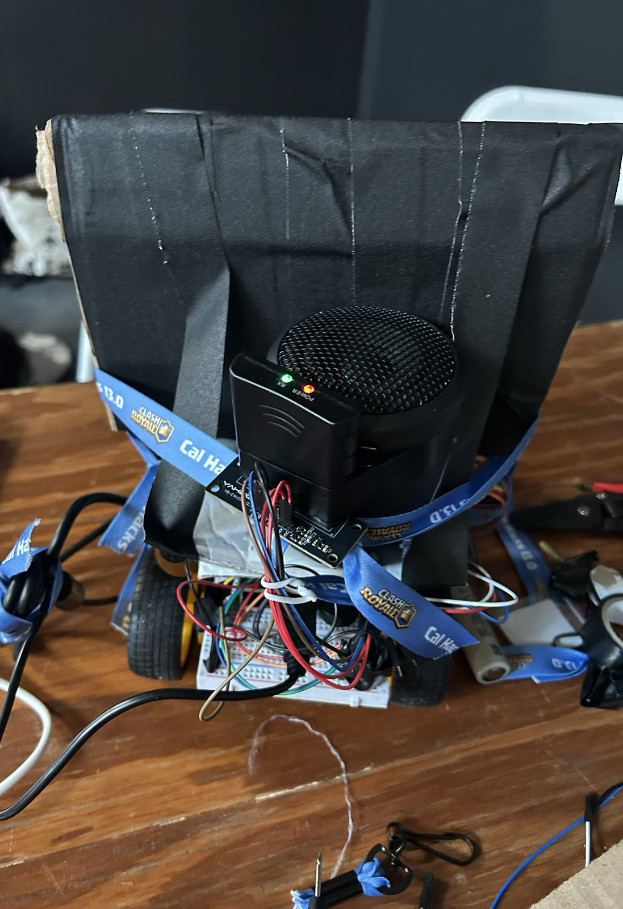
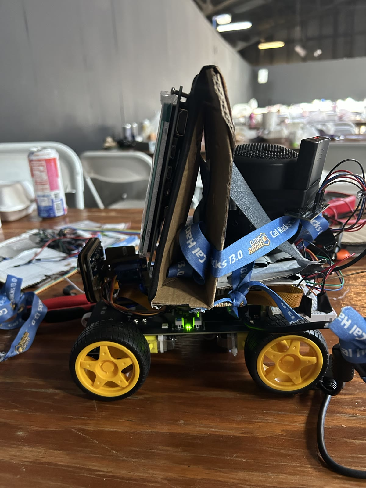
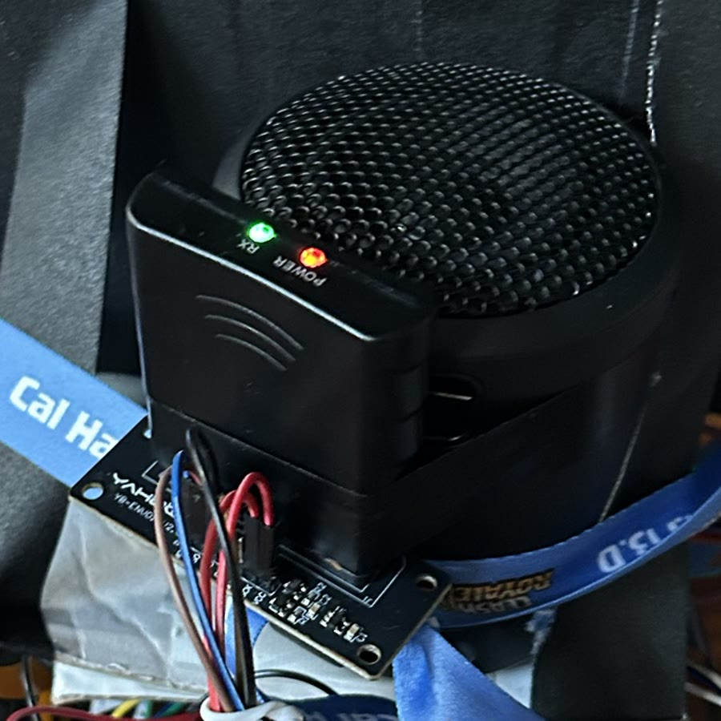
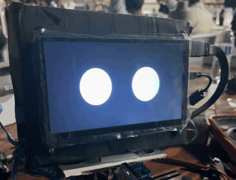
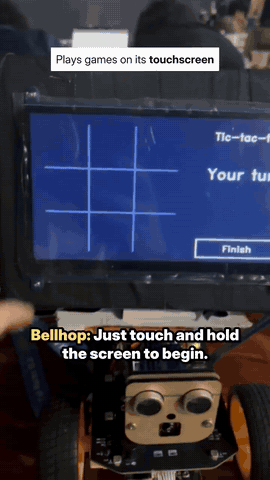

# Bellhop hardware

<table>
<tr>
<td width="50%"></td>
<td width="50%"></td>
</tr>
</table>

A Freenove 4WD car kit rebuilt to drive to a care-home room, see who is there, and talk to them,
all on a Raspberry Pi 5 with 2 GB of RAM.

> I built the hardware: assembly, wiring, power, and bringing each part up on the Pi. That happened
> on the bench, so the commit history does not show it. I also helped shape the voice agent's state
> machine and the turn controller. This write-up was added after the event. *(Jeremy Aidan Yu)*

## Parts

| Part | Job |
|---|---|
| **Freenove 4WD Smart Car Kit** | Chassis, four DC motors, PCA9685 servo driver, battery ADC, three IR line sensors, 8 RGB LEDs |
| **Raspberry Pi 5, 2 GB** | Vision, voice, triage, driving and the face |
| **Camera Module 3** | The eyes; locked focus and exposure, short shutter for sharp frames while turning |
| **Pan and tilt servos** | Aim the camera head |
| **Ultrasonic sensor** | Rides on the head and guards every forward move |
| **7 inch HDMI touchscreen** | The eyes and the touch games |
| **USB mic and speaker** | Hearing and the voice, Poppy |
| **PS2 controller and Yahboom receiver** | Backup driving, deadman on R2 |
| **Kit battery, plus 5 V for the screen** | Power |
| **ArUco markers**, 15 cm | One per door |

<table>
<tr>
<td width="50%"></td>
<td width="50%"></td>
</tr>
</table>

## Problems on the bench

### No zip ties

PROBLEM: The kit has nowhere to put a 7 inch screen, a speaker and a receiver, and the venue had no
zip ties.

SOLUTION: A cardboard and black tape enclosure on a cardboard shelf, with room for the head to move
underneath, tied down with Cal Hacks 13.0 Clash Royale lanyards.

### The screen went dark when the robot talked

PROBLEM: On battery, the Pi 5 gives its USB ports 600 mA in total. The screen and speaker shared it,
so the screen browned out whenever Poppy spoke.

SOLUTION: A separate 5 V feed into the screen's power-only port, with only touch going to the Pi.
The speaker is kept awake so waking it never re-syncs the display, and `scripts/check_power.py`
tells a power fault from a memory fault.

### 2 GB for everything

PROBLEM: Two vision models, two speech models, a voice and torch do not fit comfortably, and even
`uv sync` can get killed.

SOLUTION: YOLO26n exported to NCNN on the laptop, CPU-only torch, one process each for vision,
driving and voice, and a chat mode that loads no camera or torch.

### A PS2 remote on the SPI pins

The remote drives the robot if autonomy fails: the left stick moves it only while R2 is held, and a
released R2, a lost link or a bad frame stops the wheels. My idea; Aditya wrote the driver.

PROBLEM: The receiver speaks PS2 over GPIO 8 to 11, the Pi's SPI pins, which the kit's LED strip
also uses.

SOLUTION: Kernel SPI off, and the LEDs off in controller mode. A missing library only disables manual
control; the drive server still starts.

### The ultrasonic rides on the camera head

PROBLEM: Tilting the head up to read a marker aims the ultrasonic away from low obstacles.

SOLUTION: On `master` the head stays level and markers are mounted low. Pan stays within 30 to 150
degrees, since the +10 degree servo calibration can overdrive the end stops, and tilt within 80 to
180 to clear the chassis.

### Steering, the network, and the 11 pm reflash

With no encoders, IMU or lidar, the robot finds rooms by door markers and turns in camera-checked
pulses (my suggestion; Aditya built it). These are written up, with diagrams, in the main README:
[how it finds a room](../../README.md#how-the-robot-finds-a-room),
[steering with no encoders](../../README.md#steering-with-no-encoders-a-controls-problem),
[the venue network](../../README.md#reaching-the-robot-over-the-venue-network) and
[losing the Pi at 11 pm](../../README.md#losing-the-pi-at-11-pm).

## Safety

The wheels stop when commands stop arriving, on a stop signal, or when R2 is released. A stale
camera sends the robot back to searching, and an "emergency" light nothing refreshes goes back to
idle after 120 s. [Test checklist](../components/robot-safe-stop.md).

## The face and the games

 

The eyes follow the tone of each reply. Bingo, tic-tac-toe and memory match run on the touchscreen,
and the tic-tac-toe robot loses about 60% of its games on purpose.

## Next version

- **Wheel encoders and an IMU**, for odometry and a real map
- **Depth or lidar**, for low obstacles and SLAM
- **Raspberry Pi AI HAT+ or more RAM**, to run the face, games, vision and driving at once
- **A far-field mic array with echo cancellation**, to listen while it talks
- **A physical call bell** (ESP32 or Pico W) that sends `POST /calls`
- **A 5 A power path** for the Pi, and a separate rail for the screen and audio
- **A charging dock** found by its marker
- **A taller body**, with the face at eye level for someone in a chair or bed

Photos, clips and the shot list: [`media/`](media).
