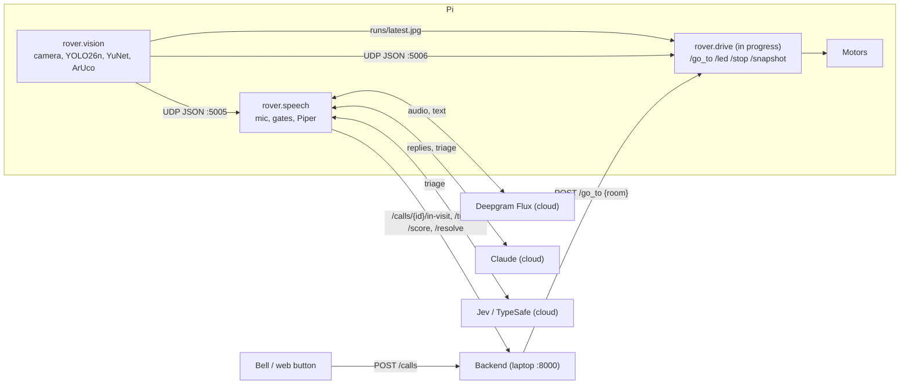

# Bellhop robot (ml/)

The code that runs on the robot (Freenove 4WD car, Raspberry Pi 5 2 GB, Camera Module 3, USB mic and speaker):

- **vision**: camera, person tracking (YOLO26n), faces (YuNet), door markers (ArUco)
- **voice**: mic, listen gates, Deepgram Flux speech-to-text, Claude replies, Piper voice "Poppy"
- **agent context**: persona, activity rules and tools for Claude (`src/rover/agent/`)
- **triage**: scores each visit and posts it to the backend (`src/rover/triage/`)

It talks to the team backend only through its HTTP API. Every command below says where it runs: **(Mac)** or **(Pi)**.



## Quick start on the Mac

```
(Mac) cd calhacks-13/ml
(Mac) uv sync
(Mac) cp .env.example .env                            # add keys; without them the code prints "fallback: <reason>"
(Mac) uv run python scripts/download_models.py        # YOLO26n -> NCNN, YuNet, Piper voice, Moonshine
(Mac) uv run python scripts/smoke.py                  # expect: SMOKE OK
```

Start the backend from its worktree (leave `BELLHOP_ROBOT_URL` unset on the Mac, so calls go to the seeded `robot_1`):

```
(Mac) cd ../../calhacks-13-backend/backend && uv sync
(Mac) BELLHOP_SEED_DEMO=1 uv run uvicorn bellhop.api.main:app --host 0.0.0.0 --port 8000
```

Add `BELLHOP_STORE=spacetimedb` to keep calls across restarts (needs `spacetime start` and the module published; see the backend's docs).

Then, in two more terminals from `ml/`:

```
(Mac) uv run python -m rover.vision --source 0 --show        # webcam window with boxes; q quits
(Mac) curl -s -X POST localhost:8000/calls -H 'Content-Type: application/json' -d '{"room":"12"}'
(Mac) uv run python -m rover.speech --call <id from the curl> --no-face
(Mac) curl -s localhost:8000/calls/<id>                      # transcript, urgency, summary
```

## Copy to the Pi

Needs Raspberry Pi OS **Bookworm 64-bit** (Python 3.11), the camera connected, SSH and internet. The current default image is Trixie (Python 3.13), which `setup_pi.sh` rejects: in Raspberry Pi Imager pick **Raspberry Pi OS (Legacy, 64-bit)**, and check with `python3 --version` on the Pi. From the folder that holds `ml/`:

```
(Mac) rsync -av --exclude .venv --exclude runs --exclude __pycache__ --exclude .env ml/ pi@<pi-host>:~/ml/
(Pi)  cd ~/ml && bash scripts/setup_pi.sh
```

- `rsync` also copies `models/`, so the NCNN folder exported on the Mac arrives with it. Run `download_models.py` on the Mac first.
- `scp -r ml pi@<pi-host>:~/` works too, but it copies the Mac's `.venv` (large, useless on the Pi; setup rebuilds it) and the Mac's `.env`.
- Re-run the same `rsync` after every code change. `.env` is excluded so the Pi keeps its own.
- Replace `pi` with your Pi's username.

`setup_pi.sh` is safe to re-run. What it does and what success looks like:

| Step | What it does | Success looks like |
| --- | --- | --- |
| 1 | Checks the Pi is aarch64 with Python 3.11 | `ok: aarch64, system Python 3.11` |
| 2 | `apt-get install python3-picamera2 libportaudio2 libgl1 libglib2.0-0` | no errors |
| 3 | Installs `uv` if missing | `success: uv 0.x` |
| 4 | Makes `.venv` with `--system-site-packages` (sees apt's picamera2) | `.venv/pyvenv.cfg` has `include-system-site-packages = true` |
| 5 | `uv sync --frozen` (CPU-only torch from the lock) | no errors |
| 6 | `download_models.py --skip-yolo`, then `smoke.py` | `models OK`, then `SMOKE OK` with a `picamera2` line and `throttled=0x0` |

Then check the hardware one piece at a time (stop `rover.vision` and Freenove's server first; only one program can use the camera):

```
(Pi) uv run python scripts/check_camera.py          # check_camera: OK ... (480, 640, 3) uint8
(Pi) uv run python -m sounddevice                    # list audio devices; put part of the names in .env
(Pi) uv run python scripts/check_level.py            # speech at 30 cm peaks around -12 to -6 dBFS
(Pi) uv run python scripts/check_marker.py --at 1.0  # marker held at 1.0 m -> MARKER_FOCAL_PX for config.py
```

## Running on the Pi

Network: install Tailscale on the Pi and the backend laptop (`curl -fsSL https://tailscale.com/install.sh | sh`, then `sudo tailscale up`; read each IP with `tailscale ip -4`).

```
(Pi, terminal 1) cd ~/ml && uv run python -m rover.vision
(Pi, terminal 2) cd ~/ml && uv run python -m rover.speech
```

Without `--call`, the voice process polls `GET /calls` for a call assigned to `ROBOT_ID`.

| Setting (`.env`) | Mac | Pi |
| --- | --- | --- |
| `BELLHOP_API` | `http://127.0.0.1:8000` | `http://<laptop-tailscale-ip>:8000` |
| `PI_SERVER_URL` | unused | `http://127.0.0.1:<robot server port>` |
| `ROBOT_ID` | `robot_1` | `robot_1` |
| `DEEPGRAM_API_KEY`, `ANTHROPIC_API_KEY`, `TYPESAFE_API_KEY` | same keys | same keys |
| `MIC_NAME`, `SPEAKER_NAME` | empty (default device) | part of the USB device names (required: the default is HDMI) |
| `BELLHOP_API_KEY` | only if the backend sets one | same |

On the backend laptop for the demo: `BELLHOP_ROBOT_URL=http://<pi-tailscale-ip>:<robot server port>`.

## Integration

**Vision message.** `rover.vision` sends one JSON per frame over UDP to `127.0.0.1:5005` (voice) and `127.0.0.1:5006` (driving):

```json
{
  "t": 1761300000.12, "fps": 12.3,
  "person": {"id": 4, "box": [x1, y1, x2, y2]},
  "face": {"box": [x, y, w, h], "score": 0.93, "facing": true, "width": 62.0},
  "markers": [{"id": 201, "room": "12", "distance_m": 1.42}]
}
```

- `person` and `face` are `null` when nothing is seen; `markers` is `[]`. A marker id missing from `MARKER_ROOMS` has `"room": null`.
- Boxes are pixels in the 640x480 frame. NaN distances are dropped before sending.
- Treat no message for 2 s (`VISION_STALE_S`) as "no vision": stop, don't guess.
- Read it: `sock = socket.socket(socket.AF_INET, socket.SOCK_DGRAM); sock.bind(("127.0.0.1", 5006)); json.loads(sock.recv(65535))`.

**Robot server (`rover.drive` on the Pi, in progress).**
- `POST /go_to {"room"}` must return 2xx at once and drive in the background. The backend waits 2 s; slower or non-2xx gives the call to a nurse only and the robot never sees it.
- `POST /led {"state"}` (`idle`, `listening`, `nurse_on_way`, `emergency`), `POST /stop`.
- `GET /snapshot` serves `~/ml/runs/latest.jpg`, which vision rewrites about once a second (atomic rename, never half a file).

**Rooms.** Printed markers are ids 201-210 (`DICT_4X4_250`, 15 cm). `config.MARKER_ROOMS` maps marker id to the backend's room string: 201 = `"12"` (Margaret), 202 = `"14"` (Arthur), 203 = `"lobby"` (home/start). If rooms change, update `MARKER_ROOMS`, the bell button and the backend residents together.

**Visit flow** (`rover.speech`):
1. Find the call: `--call <id>`, or the newest call for `ROBOT_ID` in `assigned` / `robot_en_route`.
2. Start the visit when the room's marker is 1.0 m away, a facing face is seen for 1 s, or 60 s pass: `POST /calls/{id}/in-visit` (409 "already in visit" counts as success).
3. Each resident turn: `POST /turns {"speaker": "resident"}`, triage in the background, the reply is spoken and posted as `{"speaker": "robot"}`.
4. End on goodbye, "not now" or 60 s of quiet. **Urgency 1-2**: `POST /resolve {"by_robot": true}`. **Urgency 3-4**: stay and keep talking until the call shows `nurse_acked` (or Enter is pressed), then `POST /resolve {"by_robot": false}`. Without a resolve the robot stays busy and gets no more calls.

**Triage contract.** `POST /calls/{id}/score {"urgency": 1-4, "category", "summary", "confidence": 0-1}`; 1 chat, 2 routine, 3 nurse soon, 4 emergency. Confidence below 0.6 bumps urgency up one level; a keyword floor can only raise it; urgency never goes down on a call. If the models fail: `POST /calls/{id}/triage-failed` (backend defaults to 3). The summary is one plain line for the nurse, no diagnosis. Evaluate against the labelled set (under-escalations are what matter):

```
(Mac) uv run python scripts/eval_triage.py ../../calhacks-13-backend/backend/data/labelled_cases.jsonl data/hard_cases.jsonl
```

Full API: `calhacks-13-backend/contracts/README.md` and `contracts/openapi.json`.

## Settings card

All thresholds live in `src/rover/config.py`. These are start values: tune on site and change them there, nowhere else.

| Setting | Start value | What it does |
| --- | --- | --- |
| `LENS_POSITION`, `SHUTTER_US`, `ANALOGUE_GAIN` | 0.7, 8000, 4.0 | Locked focus (1 / metres) and exposure; short shutter cuts blur while turning |
| `YOLO_IMGSZ`, `YOLO_CONF` | 320, 0.4 | Person model input size (must match the export) and confidence |
| `COAST_S` | 2.0 | Keep the last target this long after it disappears |
| `FACE_SCORE`, `FACE_SEEN_OF`, `FACE_MIN_WIDTH_PX` | 0.9, (3, 5), 40 | Face must score 0.9+, be seen in 3 of 5 frames, and be wide enough (near) |
| `MARKER_FOCAL_PX`, `ARRIVE_DISTANCE_M` | 470, 1.0 | Marker distance calibration and "arrived" distance |
| `MARKER_ROOMS` | {201: "12", 202: "14", 203: "lobby"} | Marker id to backend room |
| `SILERO_THRESHOLD`, `LOUDNESS_MARGIN_DB` | 0.5, 10 dB | Speech detector, and how far above the room's noise floor speech must be |
| `ECHO_TAIL_S` | 0.3 | Mic stays muted this long after Poppy stops |
| `EOT_THRESHOLD`, `EAGER_EOT_THRESHOLD`, `EOT_TIMEOUT_MS` | 0.8, 0.5, 3000 | Flux end-of-turn settings |
| `FLUX_TURN_LIMIT_S` | 5.0 | No Flux result this long after speech -> Moonshine offline |
| `BRAIN_MODEL`, `TRIAGE_MODEL` | Claude Sonnet, Claude Haiku | Reply model and triage model |
| `FIRST_TEXT_TIMEOUT_S`, `TRIAGE_TIMEOUT_S` | 3.0, 3.0 | Fallback line / triage give-up times |
| `JEV_ONLY_CONFIDENCE` | 0.5 | Confidence sent when only Jev answers (bumps urgency one level) |
| `VISIT_QUIET_END_S`, `VISIT_START_FALLBACK_S` | 60, 60 | End a quiet visit; start a visit without marker or face |
| `PIPER_SPEAKER_ID`, `TONES` | 3 (Poppy), table | Voice and the speed/pitch per tone tag |

## Tests

```
(Mac) uv run pytest                              # pure logic, no camera, mic, network or keys
(Mac) uv run ruff check src tests scripts
```

## Troubleshooting

Work from the bottom layer up. Check `GOTCHAS.md` too.

| Layer | Symptom | Check | Fix |
| --- | --- | --- | --- |
| Pi/Python | `setup_pi.sh` stops at step 1 | `/usr/bin/python3 --version` | Flash Raspberry Pi OS (Legacy, 64-bit), which is Bookworm with Python 3.11 |
| Pi/Python | `externally-managed-environment` | Did you run plain `pip`? | Use `uv run ...`; never pip |
| Pi/Python | `ValueError: numpy.dtype size changed` on `import picamera2` | numpy line in `scripts/smoke.py` | Must be 1.x: `uv sync --frozen` |
| Pi/Python | `Killed` in the terminal | `free -m`, swap used in `smoke.py` | Out of memory: close other programs; one vision and one voice process only |
| Pi/Python | Low fps, `throttled` not `0x0` | `vcgencmd get_throttled`, `vcgencmd measure_temp` | Official PSU or stronger battery; airflow |
| Pi/Python | Low fps, `throttled` is `0x0` | First vision line prints `OMP_NUM_THREADS=` | Try 1-3 via `config.VISION_OMP_THREADS` (or `OMP_NUM_THREADS=` before `uv run`) |
| Pi/Python | `ImportError: libGL.so.1` on `import cv2` | `dpkg -l libgl1` | `sudo apt install libgl1 libglib2.0-0` (setup does this) |
| Pi/Python | `rsync: command not found` | `which rsync` on both machines | `sudo apt install rsync` on the Pi |
| Camera | `IndexError` from `Picamera2()` | `rpicam-hello -n --list-cameras` shows `imx708` | Reseat the ribbon cable |
| Camera | Camera busy / no frames | `ps aux \| grep -i -E "freenove\|rpicam\|python"` | Stop the other camera user (Freenove server, `rpicam-*`, a check script) |
| Camera | Colours swapped (blue faces) | `check_camera.py` image | Camera must use `RGB888` (BGR order) |
| Camera | Blurry or dark | `check_camera.py` brightness | Tune `LENS_POSITION`, `SHUTTER_US`, `ANALOGUE_GAIN` |
| Models | `fallback: ... yolo26n_ncnn_model missing` | `ls models/yolo26n_ncnn_model` | (Mac) `scp -r models/yolo26n_ncnn_model pi@<pi>:~/ml/models/` |
| Models | No people found | `smoke.py` imgsz check | NCNN must be exported at `YOLO_IMGSZ`; re-export on the Mac |
| Models | No faces | Person close enough? `FACE_MIN_WIDTH_PX` | Move closer, check light; tune `FACE_MIN_WIDTH_PX` |
| Models | No markers | Printed dictionary and ids | Must be `DICT_4X4_250`, ids 201-210, with a white border |
| Mic/audio | `PortAudio library not found` | `dpkg -l libportaudio2` | `sudo apt install libportaudio2` |
| Mic/audio | Garbled transcripts | `check_level.py` peak | Mic closer (USB extension), away from fan and speaker |
| Mic/audio | Wrong mic or speaker | `uv run python -m sounddevice` | Set `MIC_NAME` / `SPEAKER_NAME` in `.env` |
| Mic/audio | `mic: cannot open ... Invalid sample rate`, visit ends with "can't hear" | Device list shows `(hw:N,0)`, not `(plughw:N,0)` | `PA_ALSA_PLUGHW` must be `1` (`config.py` sets it); don't set it to 0 in `.env` |
| Mic/audio | Robot answers itself | Transcript matches its last reply | Speaker away from mic; raise `ECHO_TAIL_S` |
| Flux | `fallback: no DEEPGRAM_API_KEY` | `.env` | Add the key (no spaces around `=`) |
| Flux | HTTP 401 / 402 | Deepgram console | 401 bad key, 402 no credit |
| Flux | Slow or no turns, then Moonshine | Network; `FLUX_TURN_LIMIT_S` | Check Wi-Fi; Moonshine covers it offline |
| Claude | Fallback line spoken | The printed `fallback:` reason | Add `ANTHROPIC_API_KEY`; check network |
| Claude | HTTP 400 | Request sends `temperature` or prefill? | Remove them; current models reject both |
| Backend | `backend ... unreachable` in `smoke.py` | `curl http://<laptop-ip>:8000/health` | Backend started with `--host 0.0.0.0`; `tailscale status`; `BELLHOP_API` |
| Backend | Robot never gets the call | `GET /calls/<id>`: `robot_id` null | `/go_to` must answer 2xx within 2 s; check `BELLHOP_ROBOT_URL` |
| Backend | 401 on every call | Backend has `BELLHOP_API_KEY` set | Set the same `BELLHOP_API_KEY` in the Pi's `.env` |
| Backend | Robot stuck busy | `GET /robots` | The visit must end with `/resolve`; resolve the call by hand |

## Credits and licences

| Part | Licence |
| --- | --- |
| Piper voice `en_GB-semaine-medium` (rhasspy/piper-voices) | CC BY-NC-SA 4.0 (non-commercial) |
| `piper-tts` (OHF-Voice/piper1-gpl) | GPL-3.0 |
| `ultralytics` and YOLO26n weights | AGPL-3.0 |
| YuNet face detector (opencv_zoo) | MIT |
| Moonshine English model (moonshine-ai) | MIT |
| Silero VAD via `pysilero-vad` | MIT |
| Freenove 4WD car drivers (if used) | CC BY-NC-SA 3.0 |

Cloud services: Deepgram Flux, Claude (Anthropic), Jev (TypeSafe). Prototype only: no diagnosis, no real patient data.
